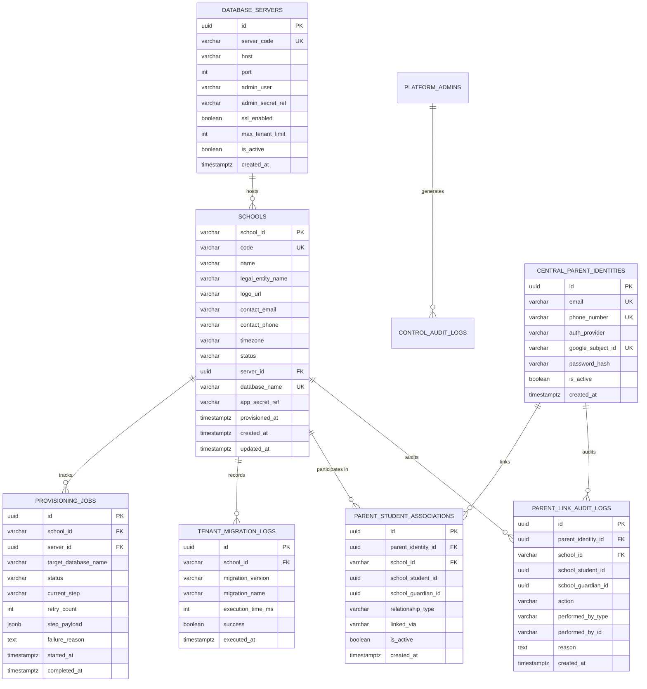
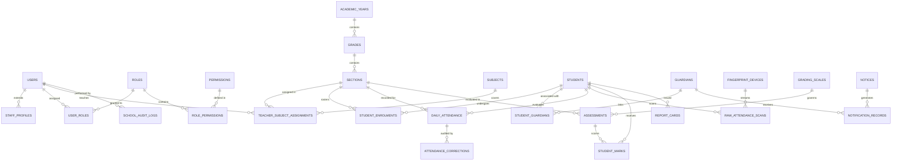
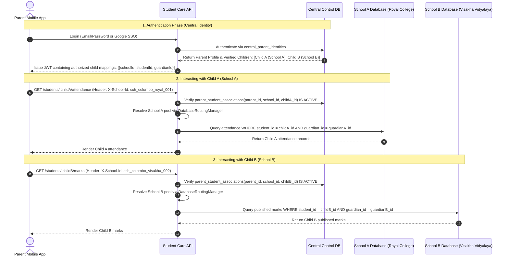
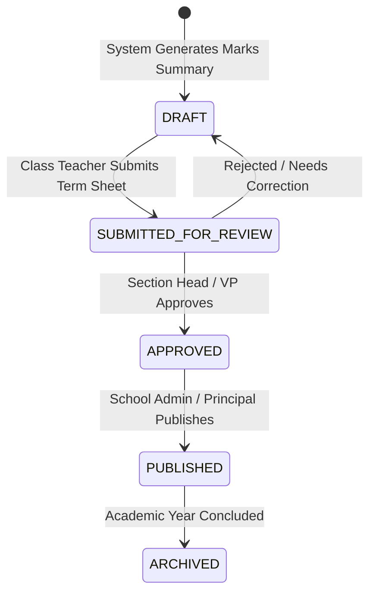
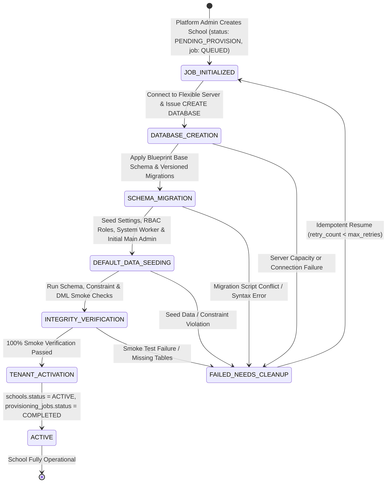

# Student Care — Database Architecture & Schema Specification

**Status:** Approved Architecture Draft  
**Target Engine:** Azure Database for PostgreSQL Flexible Server (PostgreSQL 16+)  
**Default Timezone:** `Asia/Colombo`  
**Collation / Encoding:** `UTF8` / `en_US.UTF-8`

---

## 1. Architectural Principles

Student Care enforces strict multi-tenancy through physical database isolation:

1. **Central Control Database (`student_care_control`):**
   - Single system-wide database.
   - Contains school registry, license/status, server routing catalog, provisioning jobs, and platform admin accounts.
   - Contains zero student PII, marks, or classroom attendance data.
2. **Dedicated School Databases (`sc_school_<school_id>`):**
   - Completely independent PostgreSQL database per educational institution.
   - Stores all staff, students, guardians, attendance, grades, biometric sync records, and notices for that institution.
   - Completely isolated connection pool; query errors or misconfigurations in one school cannot leak or affect another school.
3. **Central Analytics Store (`student_care_analytics`):**
   - Dedicated analytical warehouse for approved aggregated, pseudonymized reporting across schools.
   - Populated asynchronously via read-only scheduled ETL extractors.
   - Platform administrators have no direct operational query access to school databases.
4. **Server Consolidation & Migration Flexibility:**
   - Multiple tenant databases can co-exist on a single Azure Database for PostgreSQL Flexible Server instance.
   - Database routing is abstracted through server references (`server_id`), enabling seamless relocation of high-volume schools to dedicated database instances without altering application code.

---

## 2. Central Control Database Schema

The Central Control Database manages institutional metadata, provisioning workflows, and routing parameters.



### 2.1 Central Control Database DDL

```sql
-- Extension requirements
CREATE EXTENSION IF NOT EXISTS "uuid-ossp";
CREATE EXTENSION IF NOT EXISTS "pgcrypto";

-- 1. Database Servers Registry (enables multi-server scaling)
-- NOTE: Stores Key Vault secret identifiers; NEVER plaintext credentials.
CREATE TABLE database_servers (
    id UUID PRIMARY KEY DEFAULT gen_random_uuid(),
    server_code VARCHAR(50) NOT NULL UNIQUE,       -- e.g. 'azure-pg-flex-primary'
    host VARCHAR(255) NOT NULL,                    -- e.g. 'sc-prod-flex-01.postgres.database.azure.com'
    port INT NOT NULL DEFAULT 5432,
    admin_user VARCHAR(100) NOT NULL,              -- e.g. 'az_provisioner'
    admin_secret_ref VARCHAR(255) NOT NULL,        -- Key Vault reference: 'kv://kv-studentcare-prod/secrets/db-server-admin-primary'
    ssl_enabled BOOLEAN NOT NULL DEFAULT TRUE,
    max_tenant_limit INT NOT NULL DEFAULT 200,     -- capacity threshold per flexible server
    is_active BOOLEAN NOT NULL DEFAULT TRUE,
    created_at TIMESTAMPTZ NOT NULL DEFAULT CURRENT_TIMESTAMP,
    updated_at TIMESTAMPTZ NOT NULL DEFAULT CURRENT_TIMESTAMP
);

-- 2. Master School Registry
CREATE TYPE school_status_enum AS ENUM (
    'PENDING_PROVISION',
    'ACTIVE',
    'SUSPENDED',
    'MAINTENANCE',
    'ARCHIVED'
);

CREATE TABLE schools (
    school_id VARCHAR(53) PRIMARY KEY,              -- Deterministic identifier (max 53 chars to ensure sc_school_<id> <= 63 bytes)
    code VARCHAR(20) NOT NULL UNIQUE,               -- Short human code, e.g. 'RC-COL'
    name VARCHAR(255) NOT NULL,                     -- e.g. 'Royal College'
    legal_entity_name VARCHAR(255),
    logo_url VARCHAR(500),                          -- Azure Blob Storage URL for school crest/branding
    address TEXT,
    contact_email VARCHAR(255) NOT NULL,
    contact_phone VARCHAR(50) NOT NULL,
    timezone VARCHAR(50) NOT NULL DEFAULT 'Asia/Colombo',
    status school_status_enum NOT NULL DEFAULT 'PENDING_PROVISION',
    server_id UUID NOT NULL REFERENCES database_servers(id) ON DELETE RESTRICT,
    database_name VARCHAR(63) NOT NULL UNIQUE,      -- Deterministic: strictly <= 63 bytes (PostgreSQL NAMEDATALEN - 1 limit)
    app_secret_ref VARCHAR(255),                    -- Key Vault secret reference for tenant-specific role if dedicated
    provisioned_at TIMESTAMPTZ,
    created_at TIMESTAMPTZ NOT NULL DEFAULT CURRENT_TIMESTAMP,
    updated_at TIMESTAMPTZ NOT NULL DEFAULT CURRENT_TIMESTAMP,
    CONSTRAINT chk_school_id_format CHECK (school_id ~ '^[a-z0-9_]{3,53}$'),
    CONSTRAINT chk_database_name_format CHECK (database_name ~ '^sc_school_[a-z0-9_]{3,53}$' AND length(database_name) <= 63)
);

CREATE INDEX idx_schools_status ON schools(status);
CREATE INDEX idx_schools_server ON schools(server_id);

-- 3. Provisioning Jobs & State Machine Tracking
CREATE TYPE provisioning_step_enum AS ENUM (
    'JOB_INITIALIZED',
    'DATABASE_CREATION',
    'SCHEMA_MIGRATION',
    'DEFAULT_DATA_SEEDING',
    'INTEGRITY_VERIFICATION',
    'TENANT_ACTIVATION',
    'FAILED_NEEDS_CLEANUP'
);

CREATE TYPE job_status_enum AS ENUM (
    'QUEUED',
    'IN_PROGRESS',
    'COMPLETED',
    'FAILED',
    'ROLLED_BACK'
);

CREATE TABLE provisioning_jobs (
    id UUID PRIMARY KEY DEFAULT gen_random_uuid(),
    school_id VARCHAR(64) NOT NULL REFERENCES schools(school_id) ON DELETE RESTRICT,
    server_id UUID NOT NULL REFERENCES database_servers(id) ON DELETE RESTRICT,
    target_database_name VARCHAR(64) NOT NULL,
    status job_status_enum NOT NULL DEFAULT 'QUEUED',
    current_step provisioning_step_enum NOT NULL DEFAULT 'JOB_INITIALIZED',
    retry_count INT NOT NULL DEFAULT 0,
    max_retries INT NOT NULL DEFAULT 3,
    step_payload JSONB DEFAULT '{}'::jsonb,
    failure_reason TEXT,
    created_by_admin VARCHAR(100) NOT NULL,
    started_at TIMESTAMPTZ,
    completed_at TIMESTAMPTZ,
    created_at TIMESTAMPTZ NOT NULL DEFAULT CURRENT_TIMESTAMP,
    updated_at TIMESTAMPTZ NOT NULL DEFAULT CURRENT_TIMESTAMP
);

CREATE INDEX idx_provisioning_jobs_school ON provisioning_jobs(school_id);
CREATE INDEX idx_provisioning_jobs_status ON provisioning_jobs(status);

-- 4. Central Migration Version Records
CREATE TABLE tenant_migration_logs (
    id UUID PRIMARY KEY DEFAULT gen_random_uuid(),
    school_id VARCHAR(64) NOT NULL REFERENCES schools(school_id) ON DELETE CASCADE,
    migration_version VARCHAR(50) NOT NULL,         -- e.g. '20261024_001'
    migration_name VARCHAR(255) NOT NULL,
    execution_time_ms INT NOT NULL,
    success BOOLEAN NOT NULL DEFAULT TRUE,
    error_message TEXT,
    executed_at TIMESTAMPTZ NOT NULL DEFAULT CURRENT_TIMESTAMP,
    UNIQUE (school_id, migration_version)
);

-- 5. Central Parent Identity Registry & Explicit Child-Level Associations
-- Enables a single parent login to access multiple children across different schools.
-- RULE: Enforces access to each specifically linked child (student), not merely school membership.
CREATE TYPE parent_auth_provider_enum AS ENUM (
    'LOCAL',
    'GOOGLE'
);

CREATE TABLE central_parent_identities (
    id UUID PRIMARY KEY DEFAULT gen_random_uuid(),
    email VARCHAR(255) UNIQUE NOT NULL,
    phone_number VARCHAR(30) UNIQUE,                -- E.164 format, e.g. '+94771234567'
    auth_provider parent_auth_provider_enum NOT NULL DEFAULT 'LOCAL',
    google_subject_id VARCHAR(255) UNIQUE,          -- OAuth 2.0 unique subject identifier
    password_hash VARCHAR(255),                     -- Nullable if authenticated via Google SSO only
    is_active BOOLEAN NOT NULL DEFAULT TRUE,
    last_login_at TIMESTAMPTZ,
    created_at TIMESTAMPTZ NOT NULL DEFAULT CURRENT_TIMESTAMP,
    updated_at TIMESTAMPTZ NOT NULL DEFAULT CURRENT_TIMESTAMP
);

-- Explicit child-level access association across separate school databases
CREATE TABLE parent_student_associations (
    id UUID PRIMARY KEY DEFAULT gen_random_uuid(),
    parent_identity_id UUID NOT NULL REFERENCES central_parent_identities(id) ON DELETE CASCADE,
    school_id VARCHAR(64) NOT NULL REFERENCES schools(school_id) ON DELETE CASCADE,
    school_student_id UUID NOT NULL,               -- Foreign ID of the specific child in the school's isolated DB
    school_guardian_id UUID NOT NULL,              -- Foreign ID of the registered guardian profile in the school DB
    relationship_type VARCHAR(50) NOT NULL,        -- 'FATHER', 'MOTHER', 'LEGAL_GUARDIAN'
    linked_via VARCHAR(30) NOT NULL DEFAULT 'SELF_VERIFICATION', -- 'SELF_VERIFICATION', 'ADMIN_MANUAL'
    is_active BOOLEAN NOT NULL DEFAULT TRUE,
    verified_at TIMESTAMPTZ NOT NULL DEFAULT CURRENT_TIMESTAMP,
    created_at TIMESTAMPTZ NOT NULL DEFAULT CURRENT_TIMESTAMP,
    UNIQUE (parent_identity_id, school_id, school_student_id)
);

CREATE INDEX idx_parent_student_parent ON parent_student_associations(parent_identity_id);
CREATE INDEX idx_parent_student_school ON parent_student_associations(school_id);
CREATE INDEX idx_parent_student_lookup ON parent_student_associations(parent_identity_id, school_id, school_student_id);

-- Audit log for parent-child linking/unlinking actions (both self-link and admin manual)
CREATE TABLE parent_link_audit_logs (
    id UUID PRIMARY KEY DEFAULT gen_random_uuid(),
    parent_identity_id UUID NOT NULL REFERENCES central_parent_identities(id) ON DELETE CASCADE,
    school_id VARCHAR(64) NOT NULL REFERENCES schools(school_id) ON DELETE CASCADE,
    school_student_id UUID NOT NULL,               -- Explicit child reference
    school_guardian_id UUID NOT NULL,
    action VARCHAR(30) NOT NULL,                    -- 'LINKED', 'UNLINKED'
    performed_by_type VARCHAR(30) NOT NULL,         -- 'PARENT_SELF', 'PLATFORM_ADMIN'
    performed_by_id VARCHAR(100) NOT NULL,          -- Parent ID or Platform Admin ID
    reason TEXT,
    ip_address VARCHAR(45),
    user_agent TEXT,
    created_at TIMESTAMPTZ NOT NULL DEFAULT CURRENT_TIMESTAMP
);

CREATE INDEX idx_parent_link_audit_parent ON parent_link_audit_logs(parent_identity_id);
CREATE INDEX idx_parent_link_audit_school ON parent_link_audit_logs(school_id);

-- 6. Platform Administrators & Security Audit Logs
CREATE TABLE platform_admins (
    id UUID PRIMARY KEY DEFAULT gen_random_uuid(),
    email VARCHAR(255) NOT NULL UNIQUE,
    full_name VARCHAR(255) NOT NULL,
    password_hash VARCHAR(255) NOT NULL,
    mfa_secret VARCHAR(255),
    is_active BOOLEAN NOT NULL DEFAULT TRUE,
    created_at TIMESTAMPTZ NOT NULL DEFAULT CURRENT_TIMESTAMP,
    updated_at TIMESTAMPTZ NOT NULL DEFAULT CURRENT_TIMESTAMP
);

CREATE TABLE control_audit_logs (
    id UUID PRIMARY KEY DEFAULT gen_random_uuid(),
    admin_id UUID REFERENCES platform_admins(id) ON DELETE SET NULL,
    action VARCHAR(100) NOT NULL,                   -- e.g. 'SCHOOL_PROVISION_TRIGGERED', 'PARENT_MANUAL_LINK'
    target_school_id VARCHAR(64),
    ip_address VARCHAR(45),
    user_agent TEXT,
    details JSONB DEFAULT '{}'::jsonb,
    created_at TIMESTAMPTZ NOT NULL DEFAULT CURRENT_TIMESTAMP
);
```

---

## 3. Standard School Database Blueprint

Every school database (`sc_school_<school_id>`) contains identical, versioned schema definitions customized only by operational institutional data.



### 3.1 Database Roles, Ownership & Security Privileges

To enforce defense-in-depth and principle of least privilege, school databases operate with strict separation between schema owners and runtime application users:

1. **`az_provisioner` (DDL & Provisioning Owner):**
   - Cluster-level administrative role used exclusively by automated CI/CD migration runners and the tenant provisioning service.
   - Owns the database, schemas, tables, views, sequences, triggers, and stored procedures.
   - Connects only during database creation, schema migrations, and emergency platform administrative recovery.
2. **`sc_app_role` (Runtime Application Service Role):**
   - Strictly restricted to Data Manipulation Language (DML): `SELECT`, `INSERT`, `UPDATE`, `DELETE`.
   - Has `NOCREATEDB`, `NOCREATEROLE`, `NOSUPERUSER`, `NOINHERIT`.
   - **Zero DDL Privileges:** Cannot `CREATE`, `ALTER`, `DROP`, or `TRUNCATE` any tables, views, or schemas.
   - Runtime web, mobile, and background worker connections from `services/api` authenticate using credentials bound to this role.
3. **`sc_analytics_role` (Cross-School Analytics Reader):**
   - Dedicated read-only role for ETL extractor jobs. Granted `SELECT` strictly on approved aggregated or pseudonymized views.

```sql
-- 1. Database Role Provisioning (Executed by Cluster Admin on Server Initialization)
DO $$
BEGIN
    IF NOT EXISTS (SELECT 1 FROM pg_roles WHERE rolname = 'az_provisioner') THEN
        CREATE ROLE az_provisioner WITH LOGIN CREATEDB CREATEROLE NOINHERIT;
    END IF;
    IF NOT EXISTS (SELECT 1 FROM pg_roles WHERE rolname = 'sc_app_role') THEN
        CREATE ROLE sc_app_role WITH LOGIN NOCREATEDB NOCREATEROLE NOSUPERUSER NOINHERIT;
    END IF;
    IF NOT EXISTS (SELECT 1 FROM pg_roles WHERE rolname = 'sc_analytics_role') THEN
        CREATE ROLE sc_analytics_role WITH LOGIN NOCREATEDB NOCREATEROLE NOSUPERUSER NOINHERIT;
    END IF;
END $$;

-- 2. Lock down the public schema (Prevents unprivileged table creation)
REVOKE CREATE ON SCHEMA public FROM PUBLIC;
REVOKE CREATE ON SCHEMA public FROM sc_app_role;
REVOKE CREATE ON SCHEMA public FROM sc_analytics_role;
GRANT USAGE ON SCHEMA public TO sc_app_role;
GRANT USAGE ON SCHEMA public TO sc_analytics_role;

-- 3. Configure Default Privileges for all future objects created by az_provisioner
ALTER DEFAULT PRIVILEGES FOR ROLE az_provisioner IN SCHEMA public 
    GRANT SELECT, INSERT, UPDATE, DELETE ON TABLES TO sc_app_role;
ALTER DEFAULT PRIVILEGES FOR ROLE az_provisioner IN SCHEMA public 
    GRANT USAGE, SELECT ON SEQUENCES TO sc_app_role;
ALTER DEFAULT PRIVILEGES FOR ROLE az_provisioner IN SCHEMA public 
    GRANT SELECT ON TABLES TO sc_analytics_role;
```

### 3.2 School Database Core DDL (Strict Dependency Order)

All tables, constraints, and sequences are defined in strict topological dependency order to guarantee clean execution:

```sql
-- Extensions
CREATE EXTENSION IF NOT EXISTS "uuid-ossp";
CREATE EXTENSION IF NOT EXISTS "pgcrypto";

-- ============================================================================
-- 1. Identity, Staff Profiles & Custom RBAC Permission Model
-- ============================================================================

-- School staff authenticate using School ID (resolved at route level) + Staff ID + Password.
CREATE TABLE users (
    id UUID PRIMARY KEY DEFAULT gen_random_uuid(),
    staff_id VARCHAR(50) NOT NULL UNIQUE,          -- Official Staff ID (e.g. 'EMP-1042') used for login
    email VARCHAR(255) NOT NULL UNIQUE,            -- Mandatory email for notifications and recovery
    password_hash VARCHAR(255) NOT NULL,
    full_name VARCHAR(255) NOT NULL,
    phone_number VARCHAR(30),
    is_primary_admin BOOLEAN NOT NULL DEFAULT FALSE, -- Persistent Main School Administrator flag
    is_active BOOLEAN NOT NULL DEFAULT TRUE,
    last_login_at TIMESTAMPTZ,
    created_at TIMESTAMPTZ NOT NULL DEFAULT CURRENT_TIMESTAMP,
    updated_at TIMESTAMPTZ NOT NULL DEFAULT CURRENT_TIMESTAMP
);

CREATE INDEX idx_users_staff_id ON users(staff_id);

-- Enforces at most ONE persistent Main School Administrator per school database
CREATE UNIQUE INDEX uq_primary_admin ON users(is_primary_admin) WHERE is_primary_admin = TRUE;

-- Staff Profile: Stores HR and descriptive title metadata
-- CRITICAL RULE: Designation / Job Title is purely descriptive metadata; it grants ZERO permissions.
-- All access is authorized strictly via roles and permissions.
CREATE TABLE staff_profiles (
    user_id UUID PRIMARY KEY REFERENCES users(id) ON DELETE CASCADE,
    designation VARCHAR(100) NOT NULL,              -- e.g. 'Principal', 'Vice Principal', 'Senior Teacher' (Non-authorizing)
    nic_hash VARCHAR(64),                           -- Masked/hashed National Identity Card
    joined_date DATE NOT NULL,
    emergency_contact VARCHAR(100),
    created_at TIMESTAMPTZ NOT NULL DEFAULT CURRENT_TIMESTAMP
);

-- Granular System Permissions
CREATE TABLE permissions (
    id UUID PRIMARY KEY DEFAULT gen_random_uuid(),
    code VARCHAR(100) NOT NULL UNIQUE,             -- e.g. 'attendance.view', 'attendance.correct', 'marks.submit', 'marks.publish', 'report_cards.publish'
    module VARCHAR(50) NOT NULL,                    -- 'ATTENDANCE', 'ACADEMICS', 'STAFF', 'STUDENTS', 'NOTICES', 'SYSTEM'
    description TEXT NOT NULL
);

-- Custom and System Roles
CREATE TABLE roles (
    id UUID PRIMARY KEY DEFAULT gen_random_uuid(),
    name VARCHAR(50) NOT NULL UNIQUE,              -- e.g. 'Main Administrator', 'Teacher', 'Section Head'
    is_system BOOLEAN NOT NULL DEFAULT FALSE,      -- System roles cannot be deleted or have critical permissions stripped
    description TEXT,
    created_at TIMESTAMPTZ NOT NULL DEFAULT CURRENT_TIMESTAMP
);

CREATE TABLE role_permissions (
    role_id UUID NOT NULL REFERENCES roles(id) ON DELETE CASCADE,
    permission_id UUID NOT NULL REFERENCES permissions(id) ON DELETE CASCADE,
    PRIMARY KEY (role_id, permission_id)
);

-- User Role Assignments (with audit of who assigned the role)
-- RULE: Users are strictly forbidden from modifying their own roles or self-elevating privileges.
CREATE TABLE user_roles (
    user_id UUID NOT NULL REFERENCES users(id) ON DELETE CASCADE,
    role_id UUID NOT NULL REFERENCES roles(id) ON DELETE RESTRICT,
    assigned_by_user_id UUID REFERENCES users(id) ON DELETE RESTRICT,
    assigned_at TIMESTAMPTZ NOT NULL DEFAULT CURRENT_TIMESTAMP,
    PRIMARY KEY (user_id, role_id)
);

-- ============================================================================
-- 2. School Configuration & Operational Audit Log
-- ============================================================================

-- Enforces exactly ONE configuration record per school database at database engine level.
-- Placed after `users` to satisfy foreign key constraint `updated_by_user_id REFERENCES users(id)`.
CREATE TABLE school_settings (
    id INT PRIMARY KEY DEFAULT 1 CHECK (id = 1),   -- Singleton row invariant: prevents multiple settings profiles
    arrival_window_start TIME NOT NULL DEFAULT '04:00:00', -- Default 4:00 AM
    arrival_window_end TIME NOT NULL DEFAULT '14:00:00',   -- Default 2:00 PM
    school_timezone VARCHAR(50) NOT NULL DEFAULT 'Asia/Colombo',
    auto_absence_enabled BOOLEAN NOT NULL DEFAULT TRUE,
    auto_absence_evaluation_time TIME NOT NULL DEFAULT '14:00:00',
    offline_sync_grace_minutes INT NOT NULL DEFAULT 60,    -- Wait time for offline device sync before finalizing absence alerts
    updated_by_user_id UUID REFERENCES users(id) ON DELETE SET NULL, -- Restricted to user with settings.manage permission
    updated_at TIMESTAMPTZ NOT NULL DEFAULT CURRENT_TIMESTAMP,
    CONSTRAINT chk_arrival_window CHECK (arrival_window_end > arrival_window_start),
    CONSTRAINT chk_grace_period CHECK (offline_sync_grace_minutes >= 0 AND offline_sync_grace_minutes <= 360)
);

-- School Security & Operational Audit Log
-- Placed before stored procedures so that handover and recovery functions can log into it.
CREATE TABLE school_audit_logs (
    id UUID PRIMARY KEY DEFAULT gen_random_uuid(),
    user_id UUID REFERENCES users(id) ON DELETE SET NULL,
    user_role VARCHAR(50),
    action VARCHAR(100) NOT NULL,                   -- e.g. 'PRIMARY_ADMIN_HANDOVER', 'ATTENDANCE_CORRECTED', 'MARKS_PUBLISHED'
    entity_name VARCHAR(100) NOT NULL,              -- e.g. 'users', 'daily_attendance', 'assessments', 'school_settings'
    entity_id VARCHAR(100) NOT NULL,
    old_values JSONB,
    new_values JSONB,
    ip_address VARCHAR(45),
    user_agent TEXT,
    created_at TIMESTAMPTZ NOT NULL DEFAULT CURRENT_TIMESTAMP
);

CREATE INDEX idx_school_audit_user ON school_audit_logs(user_id);
CREATE INDEX idx_school_audit_action ON school_audit_logs(action);
CREATE INDEX idx_school_audit_created ON school_audit_logs(created_at);

-- ============================================================================
-- 3. Academic Calendar, Grades, Sections & Cross-Table Consistency
-- ============================================================================

CREATE TABLE academic_years (
    id UUID PRIMARY KEY DEFAULT gen_random_uuid(),
    name VARCHAR(50) NOT NULL UNIQUE,               -- e.g. '2026/2027'
    start_date DATE NOT NULL,
    end_date DATE NOT NULL,
    is_current BOOLEAN NOT NULL DEFAULT FALSE,
    created_at TIMESTAMPTZ NOT NULL DEFAULT CURRENT_TIMESTAMP,
    CONSTRAINT chk_academic_dates CHECK (end_date > start_date)
);

CREATE TABLE grades (
    id UUID PRIMARY KEY DEFAULT gen_random_uuid(),
    name VARCHAR(50) NOT NULL,                     -- e.g. 'Grade 10'
    numeric_order INT NOT NULL,                     -- e.g. 10
    created_at TIMESTAMPTZ NOT NULL DEFAULT CURRENT_TIMESTAMP,
    UNIQUE (name)
);

CREATE TABLE sections (
    id UUID PRIMARY KEY DEFAULT gen_random_uuid(),
    academic_year_id UUID NOT NULL REFERENCES academic_years(id) ON DELETE RESTRICT,
    grade_id UUID NOT NULL REFERENCES grades(id) ON DELETE RESTRICT,
    name VARCHAR(50) NOT NULL,                     -- e.g. 'Section A' / '10-A'
    class_teacher_id UUID REFERENCES users(id) ON DELETE SET NULL, -- Assigned Class Teacher
    room_number VARCHAR(50),
    created_at TIMESTAMPTZ NOT NULL DEFAULT CURRENT_TIMESTAMP,
    UNIQUE (academic_year_id, grade_id, name),
    CONSTRAINT uq_sections_year UNIQUE (id, academic_year_id) -- Enables cross-table composite foreign keys
);

CREATE TABLE subjects (
    id UUID PRIMARY KEY DEFAULT gen_random_uuid(),
    code VARCHAR(50) NOT NULL UNIQUE,               -- e.g. 'MATH-10'
    name VARCHAR(100) NOT NULL,                     -- e.g. 'Mathematics'
    description TEXT,
    created_at TIMESTAMPTZ NOT NULL DEFAULT CURRENT_TIMESTAMP
);

-- Teacher assignments to subjects and sections (Enforces attendance/marks edit scope)
CREATE TABLE teacher_subject_assignments (
    id UUID PRIMARY KEY DEFAULT gen_random_uuid(),
    academic_year_id UUID NOT NULL REFERENCES academic_years(id) ON DELETE RESTRICT,
    section_id UUID NOT NULL REFERENCES sections(id) ON DELETE RESTRICT,
    subject_id UUID NOT NULL REFERENCES subjects(id) ON DELETE RESTRICT,
    teacher_id UUID NOT NULL REFERENCES users(id) ON DELETE RESTRICT,
    assigned_at TIMESTAMPTZ NOT NULL DEFAULT CURRENT_TIMESTAMP,
    UNIQUE (academic_year_id, section_id, subject_id, teacher_id),
    CONSTRAINT fk_teacher_assignment_section_year FOREIGN KEY (section_id, academic_year_id) 
        REFERENCES sections(id, academic_year_id) ON DELETE RESTRICT
);

CREATE INDEX idx_teacher_assignments ON teacher_subject_assignments(teacher_id, section_id);

-- ============================================================================
-- 4. Students, Guardians & Family Links
-- ============================================================================

CREATE TYPE student_status_enum AS ENUM (
    'ACTIVE',
    'SUSPENDED',
    'TRANSFERRED_OUT',
    'GRADUATED',
    'DECEASED'
);

CREATE TABLE students (
    id UUID PRIMARY KEY DEFAULT gen_random_uuid(),
    admission_number VARCHAR(50) NOT NULL UNIQUE,  -- Official school registration number
    admission_date DATE NOT NULL,
    first_name VARCHAR(100) NOT NULL,
    last_name VARCHAR(100) NOT NULL,
    full_name VARCHAR(255) NOT NULL,
    date_of_birth DATE NOT NULL,
    gender VARCHAR(20) NOT NULL,
    blood_group VARCHAR(10),
    medical_notes TEXT,
    biometric_pin VARCHAR(32) UNIQUE,               -- Unique hardware device reference (never raw fingerprint)
    status student_status_enum NOT NULL DEFAULT 'ACTIVE',
    created_at TIMESTAMPTZ NOT NULL DEFAULT CURRENT_TIMESTAMP,
    updated_at TIMESTAMPTZ NOT NULL DEFAULT CURRENT_TIMESTAMP
);

CREATE INDEX idx_students_admission ON students(admission_number);
CREATE INDEX idx_students_status ON students(status);

-- Student enrolments enforce that the section belongs to the identical academic year
CREATE TABLE student_enrolments (
    id UUID PRIMARY KEY DEFAULT gen_random_uuid(),
    student_id UUID NOT NULL REFERENCES students(id) ON DELETE CASCADE,
    academic_year_id UUID NOT NULL REFERENCES academic_years(id) ON DELETE RESTRICT,
    section_id UUID NOT NULL REFERENCES sections(id) ON DELETE RESTRICT,
    roll_number INT,
    enrolled_at DATE NOT NULL DEFAULT CURRENT_DATE,
    created_at TIMESTAMPTZ NOT NULL DEFAULT CURRENT_TIMESTAMP,
    UNIQUE (student_id, academic_year_id),
    CONSTRAINT uq_enrolment_student_section UNIQUE (student_id, academic_year_id, section_id),
    CONSTRAINT fk_enrolment_section_year FOREIGN KEY (section_id, academic_year_id) 
        REFERENCES sections(id, academic_year_id) ON DELETE RESTRICT
);

CREATE INDEX idx_enrolments_section ON student_enrolments(section_id);

CREATE TABLE guardians (
    id UUID PRIMARY KEY DEFAULT gen_random_uuid(),
    first_name VARCHAR(100) NOT NULL,
    last_name VARCHAR(100) NOT NULL,
    relationship VARCHAR(50) NOT NULL,              -- 'FATHER', 'MOTHER', 'LEGAL_GUARDIAN'
    phone_primary VARCHAR(30) NOT NULL,
    phone_secondary VARCHAR(30),
    email VARCHAR(255),
    occupation VARCHAR(100),
    nic_encrypted BYTEA,                            -- AES-256 encrypted National Identity Card
    nic_hash VARCHAR(64) UNIQUE,                    -- Deterministic HMAC-SHA256 hash for exact-match lookups & self-linking
    address TEXT,
    is_emergency_contact BOOLEAN NOT NULL DEFAULT TRUE,
    created_at TIMESTAMPTZ NOT NULL DEFAULT CURRENT_TIMESTAMP,
    updated_at TIMESTAMPTZ NOT NULL DEFAULT CURRENT_TIMESTAMP
);

CREATE INDEX idx_guardians_phone ON guardians(phone_primary);
CREATE INDEX idx_guardians_nic_hash ON guardians(nic_hash);

CREATE TABLE student_guardians (
    student_id UUID NOT NULL REFERENCES students(id) ON DELETE CASCADE,
    guardian_id UUID NOT NULL REFERENCES guardians(id) ON DELETE CASCADE,
    is_primary BOOLEAN NOT NULL DEFAULT FALSE,
    can_pickup BOOLEAN NOT NULL DEFAULT TRUE,
    created_at TIMESTAMPTZ NOT NULL DEFAULT CURRENT_TIMESTAMP,
    PRIMARY KEY (student_id, guardian_id)
);

-- ============================================================================
-- 5. Biometric Devices, Adapters, Offline Sync & Raw Scan Stream
-- ============================================================================

CREATE TYPE device_status_enum AS ENUM (
    'ONLINE',
    'OFFLINE',
    'MAINTENANCE',
    'DECOMMISSIONED'
);

CREATE TYPE device_adapter_enum AS ENUM (
    'ZKTECO_STANDALONE',
    'HIKVISION_ISAPI',
    'DAHUA_CGI',
    'GENERIC_REST'
);

CREATE TABLE fingerprint_devices (
    id UUID PRIMARY KEY DEFAULT gen_random_uuid(),
    device_identifier VARCHAR(100) NOT NULL UNIQUE, -- Serial number or hardware MAC
    name VARCHAR(100) NOT NULL,                     -- e.g. 'Main Gate Terminal 01'
    adapter_type device_adapter_enum NOT NULL DEFAULT 'ZKTECO_STANDALONE',
    location_description VARCHAR(255),
    ip_address VARCHAR(45),
    api_secret_hash VARCHAR(255) NOT NULL,          -- Token used by device adapter/gateway to push scans
    firmware_version VARCHAR(50),
    last_heartbeat_at TIMESTAMPTZ,
    last_sync_at TIMESTAMPTZ,
    status device_status_enum NOT NULL DEFAULT 'OFFLINE',
    created_at TIMESTAMPTZ NOT NULL DEFAULT CURRENT_TIMESTAMP,
    updated_at TIMESTAMPTZ NOT NULL DEFAULT CURRENT_TIMESTAMP
);

-- Raw event stream buffering offline syncs, deduplicating, and flagging anomalies
CREATE TABLE raw_attendance_scans (
    id UUID PRIMARY KEY DEFAULT gen_random_uuid(),
    device_id UUID NOT NULL REFERENCES fingerprint_devices(id) ON DELETE RESTRICT,
    student_id UUID NOT NULL REFERENCES students(id) ON DELETE CASCADE,
    scanned_at TIMESTAMPTZ NOT NULL,                -- Device physical scan timestamp (in school local timezone)
    device_event_id VARCHAR(100),                   -- Unique sequence identifier reported by hardware
    verification_mode VARCHAR(30) DEFAULT 'FINGERPRINT', -- 'FINGERPRINT', 'PIN', 'RFID_CARD'
    ingested_at TIMESTAMPTZ NOT NULL DEFAULT CURRENT_TIMESTAMP,
    is_processed BOOLEAN NOT NULL DEFAULT FALSE,
    is_flagged BOOLEAN NOT NULL DEFAULT FALSE,      -- Set to TRUE if scan is outside window, rapid duplicate, etc.
    flag_reason VARCHAR(100),                       -- 'RAPID_DUPLICATE_SCAN', 'OUTSIDE_ARRIVAL_WINDOW', 'CLOCK_DRIFT_SUSPECTED'
    reviewed_by_user_id UUID REFERENCES users(id) ON DELETE SET NULL,
    reviewed_at TIMESTAMPTZ,
    CONSTRAINT uq_device_event UNIQUE (device_id, device_event_id)
);

CREATE INDEX idx_raw_scans_unprocessed ON raw_attendance_scans(is_processed) WHERE is_processed = FALSE;
CREATE INDEX idx_raw_scans_flagged ON raw_attendance_scans(is_flagged) WHERE is_flagged = TRUE;
CREATE INDEX idx_raw_scans_student_time ON raw_attendance_scans(student_id, scanned_at);

-- ============================================================================
-- 6. Canonical Daily Attendance, State Evaluation & Audit Corrections
-- ============================================================================

CREATE TYPE attendance_status_enum AS ENUM (
    'PRESENT',
    'ABSENT',
    'LATE',
    'HALF_DAY',
    'EXCUSED'
);

CREATE TYPE attendance_source_enum AS ENUM (
    'BIOMETRIC_TERMINAL',
    'TEACHER_MANUAL',
    'ADMIN_CORRECTION',
    'SYSTEM_AUTOMATIC_ABSENCE'
);

CREATE TABLE daily_attendance (
    id UUID PRIMARY KEY DEFAULT gen_random_uuid(),
    student_id UUID NOT NULL REFERENCES students(id) ON DELETE CASCADE,
    date DATE NOT NULL,
    academic_year_id UUID NOT NULL REFERENCES academic_years(id) ON DELETE RESTRICT,
    section_id UUID NOT NULL REFERENCES sections(id) ON DELETE RESTRICT,
    status attendance_status_enum NOT NULL,
    source attendance_source_enum NOT NULL,
    check_in_time TIMESTAMPTZ,
    check_out_time TIMESTAMPTZ,
    late_minutes INT DEFAULT 0,
    remarks VARCHAR(255),
    marked_by_user_id UUID REFERENCES users(id) ON DELETE SET NULL,
    created_at TIMESTAMPTZ NOT NULL DEFAULT CURRENT_TIMESTAMP,
    updated_at TIMESTAMPTZ NOT NULL DEFAULT CURRENT_TIMESTAMP,
    UNIQUE (student_id, date),
    CONSTRAINT fk_daily_attendance_enrolment FOREIGN KEY (student_id, academic_year_id, section_id)
        REFERENCES student_enrolments(student_id, academic_year_id, section_id) ON DELETE RESTRICT,
    CONSTRAINT fk_daily_attendance_section_year FOREIGN KEY (section_id, academic_year_id) 
        REFERENCES sections(id, academic_year_id) ON DELETE RESTRICT,
    CONSTRAINT chk_attendance_times CHECK (check_out_time IS NULL OR check_in_time IS NULL OR check_out_time >= check_in_time),
    CONSTRAINT chk_late_minutes CHECK (late_minutes >= 0)
);

CREATE INDEX idx_daily_attendance_date_section ON daily_attendance(date, section_id);
CREATE INDEX idx_daily_attendance_student_date ON daily_attendance(student_id, date);

-- Audit history for manual attendance adjustments & teacher corrections
-- RULE: Teachers can correct attendance ONLY within their assigned classes
CREATE TABLE attendance_corrections (
    id UUID PRIMARY KEY DEFAULT gen_random_uuid(),
    daily_attendance_id UUID NOT NULL REFERENCES daily_attendance(id) ON DELETE CASCADE,
    previous_status attendance_status_enum NOT NULL,
    corrected_status attendance_status_enum NOT NULL,
    reason TEXT NOT NULL,
    corrected_by_user_id UUID NOT NULL REFERENCES users(id) ON DELETE RESTRICT,
    applied_at TIMESTAMPTZ NOT NULL DEFAULT CURRENT_TIMESTAMP
);

CREATE INDEX idx_attendance_corrections_daily ON attendance_corrections(daily_attendance_id);

-- ============================================================================
-- 7. Academics, Assessments, Marks Workflow & Report Card Publication
-- ============================================================================

CREATE TABLE grading_scales (
    id UUID PRIMARY KEY DEFAULT gen_random_uuid(),
    name VARCHAR(100) NOT NULL,                     -- e.g. 'National O/L Standard Scale'
    is_default BOOLEAN NOT NULL DEFAULT FALSE,
    rules JSONB NOT NULL,                           -- e.g. [{"grade": "A", "min": 75, "max": 100}, ...]
    created_at TIMESTAMPTZ NOT NULL DEFAULT CURRENT_TIMESTAMP
);

CREATE TYPE assessment_type_enum AS ENUM (
    'TERM_EXAM',
    'MID_TERM',
    'UNIT_TEST',
    'ASSIGNMENT',
    'PRACTICAL'
);

CREATE TYPE assessment_status_enum AS ENUM (
    'DRAFT',
    'MARKS_SUBMITTED',     -- Submitted by Teacher
    'PUBLISHED',           -- Approved & Published by School Administrator
    'ARCHIVED'
);

CREATE TABLE assessments (
    id UUID PRIMARY KEY DEFAULT gen_random_uuid(),
    academic_year_id UUID NOT NULL REFERENCES academic_years(id) ON DELETE RESTRICT,
    section_id UUID NOT NULL REFERENCES sections(id) ON DELETE RESTRICT,
    subject_id UUID NOT NULL REFERENCES subjects(id) ON DELETE RESTRICT,
    grading_scale_id UUID REFERENCES grading_scales(id) ON DELETE RESTRICT, -- Nullable: defaults to active is_default scale if omitted
    title VARCHAR(150) NOT NULL,                    -- e.g. 'Term 1 Final Examination'
    assessment_type assessment_type_enum NOT NULL,
    status assessment_status_enum NOT NULL DEFAULT 'DRAFT',
    max_marks NUMERIC(5, 2) NOT NULL DEFAULT 100.00,
    weightage_percentage NUMERIC(5, 2) DEFAULT 100.00,
    assessment_date DATE NOT NULL,
    is_submitted BOOLEAN NOT NULL DEFAULT FALSE,
    submitted_by_user_id UUID REFERENCES users(id) ON DELETE SET NULL,
    submitted_at TIMESTAMPTZ,
    is_published BOOLEAN NOT NULL DEFAULT FALSE,
    published_by_user_id UUID REFERENCES users(id) ON DELETE SET NULL, -- Restricted to users with marks.publish permission
    published_at TIMESTAMPTZ,
    created_by_user_id UUID NOT NULL REFERENCES users(id) ON DELETE RESTRICT,
    created_at TIMESTAMPTZ NOT NULL DEFAULT CURRENT_TIMESTAMP,
    CONSTRAINT fk_assessment_section_year FOREIGN KEY (section_id, academic_year_id) 
        REFERENCES sections(id, academic_year_id) ON DELETE RESTRICT,
    CONSTRAINT chk_assessment_max_marks CHECK (max_marks > 0),
    CONSTRAINT chk_assessment_weightage CHECK (weightage_percentage >= 0 AND weightage_percentage <= 100)
);

CREATE TABLE student_marks (
    id UUID PRIMARY KEY DEFAULT gen_random_uuid(),
    assessment_id UUID NOT NULL REFERENCES assessments(id) ON DELETE CASCADE,
    student_id UUID NOT NULL REFERENCES students(id) ON DELETE CASCADE,
    marks_obtained NUMERIC(5, 2),                   -- NULL if student was absent
    is_absent BOOLEAN NOT NULL DEFAULT FALSE,
    letter_grade VARCHAR(10),                       -- Computed e.g. 'A', 'B', 'C', 'S', 'F'
    teacher_remarks VARCHAR(255),
    entered_by_user_id UUID NOT NULL REFERENCES users(id) ON DELETE RESTRICT,
    created_at TIMESTAMPTZ NOT NULL DEFAULT CURRENT_TIMESTAMP,
    updated_at TIMESTAMPTZ NOT NULL DEFAULT CURRENT_TIMESTAMP,
    UNIQUE (assessment_id, student_id),
    CONSTRAINT chk_student_marks_value CHECK (marks_obtained IS NULL OR (marks_obtained >= 0 AND marks_obtained <= 1000)),
    CONSTRAINT chk_student_marks_absent CHECK ((is_absent = TRUE AND marks_obtained IS NULL) OR (is_absent = FALSE))
);

-- Report Cards with Formal Publication Lifecycle
CREATE TYPE report_card_status_enum AS ENUM (
    'DRAFT',
    'SUBMITTED_FOR_REVIEW',
    'APPROVED',
    'PUBLISHED',
    'ARCHIVED'
);

CREATE TABLE report_cards (
    id UUID PRIMARY KEY DEFAULT gen_random_uuid(),
    academic_year_id UUID NOT NULL REFERENCES academic_years(id) ON DELETE RESTRICT,
    student_id UUID NOT NULL REFERENCES students(id) ON DELETE CASCADE,
    term VARCHAR(50) NOT NULL,                      -- e.g. 'Term 1'
    status report_card_status_enum NOT NULL DEFAULT 'DRAFT',
    summary_data JSONB NOT NULL,                    -- Pre-calculated marks, averages, class ranks
    principal_remarks TEXT,
    class_teacher_remarks TEXT,
    generated_by_user_id UUID REFERENCES users(id) ON DELETE SET NULL,
    generated_at TIMESTAMPTZ NOT NULL DEFAULT CURRENT_TIMESTAMP,
    reviewed_by_user_id UUID REFERENCES users(id) ON DELETE SET NULL,
    reviewed_at TIMESTAMPTZ,
    published_by_user_id UUID REFERENCES users(id) ON DELETE SET NULL, -- Restricted to report_cards.publish permission
    published_at TIMESTAMPTZ,
    issued_date DATE NOT NULL DEFAULT CURRENT_DATE,
    created_at TIMESTAMPTZ NOT NULL DEFAULT CURRENT_TIMESTAMP,
    updated_at TIMESTAMPTZ NOT NULL DEFAULT CURRENT_TIMESTAMP,
    UNIQUE (academic_year_id, student_id, term)
);

CREATE INDEX idx_report_cards_student_published ON report_cards(student_id, status) WHERE status = 'PUBLISHED';

-- ============================================================================
-- 8. Notices, Notification Delivery & Safe Idempotent Retries
-- ============================================================================

CREATE TYPE notice_target_type_enum AS ENUM (
    'ALL_SCHOOL',
    'SPECIFIC_GRADES',
    'SPECIFIC_SECTIONS',
    'INDIVIDUAL_STUDENTS'
);

CREATE TABLE notices (
    id UUID PRIMARY KEY DEFAULT gen_random_uuid(),
    title VARCHAR(255) NOT NULL,
    content TEXT NOT NULL,
    target_type notice_target_type_enum NOT NULL DEFAULT 'ALL_SCHOOL',
    target_criteria JSONB DEFAULT '{}'::jsonb,      -- Filter rules e.g. {"grade_ids": [...]}
    published_by_user_id UUID NOT NULL REFERENCES users(id) ON DELETE RESTRICT,
    published_at TIMESTAMPTZ NOT NULL DEFAULT CURRENT_TIMESTAMP,
    is_active BOOLEAN NOT NULL DEFAULT TRUE,
    created_at TIMESTAMPTZ NOT NULL DEFAULT CURRENT_TIMESTAMP
);

-- Transactional Outbox & Notification Delivery
-- RULE: Notifications are enqueued inside the same ACID transaction as the triggering operational event
CREATE TYPE delivery_status_enum AS ENUM (
    'PENDING',
    'PROCESSING',
    'SENT',
    'DELIVERED',
    'READ',
    'CANCELLED',
    'FAILED',
    'EXHAUSTED'
);

CREATE TABLE notification_records (
    id UUID PRIMARY KEY DEFAULT gen_random_uuid(),
    idempotency_key VARCHAR(100) NOT NULL UNIQUE,   -- e.g. 'notif_att_absent_sch01_stu42_20261024_push'
    notice_id UUID REFERENCES notices(id) ON DELETE SET NULL,
    guardian_id UUID NOT NULL REFERENCES guardians(id) ON DELETE CASCADE,
    student_id UUID REFERENCES students(id) ON DELETE SET NULL,
    notification_type VARCHAR(50) NOT NULL,         -- 'ATTENDANCE_ALERT', 'EXAM_MARK', 'CIRCULAR'
    channel VARCHAR(30) NOT NULL DEFAULT 'PUSH',   -- 'PUSH', 'SMS', 'EMAIL'
    delivery_status delivery_status_enum NOT NULL DEFAULT 'PENDING',
    payload JSONB NOT NULL DEFAULT '{}'::jsonb,     -- Serialized message content, recipient device token/phone, and template parameters
    retry_count INT NOT NULL DEFAULT 0,
    max_retries INT NOT NULL DEFAULT 3,
    next_retry_at TIMESTAMPTZ,
    sent_at TIMESTAMPTZ,
    read_at TIMESTAMPTZ,
    failure_reason VARCHAR(255),
    created_at TIMESTAMPTZ NOT NULL DEFAULT CURRENT_TIMESTAMP,
    updated_at TIMESTAMPTZ NOT NULL DEFAULT CURRENT_TIMESTAMP
);

CREATE INDEX idx_notifications_guardian ON notification_records(guardian_id);
CREATE INDEX idx_notifications_status ON notification_records(delivery_status);
CREATE INDEX idx_notifications_retry ON notification_records(next_retry_at) WHERE delivery_status = 'FAILED';
CREATE INDEX idx_notifications_outbox ON notification_records(delivery_status, created_at) WHERE delivery_status = 'PENDING';
```

### 3.3 Main Administrator Handover, Recovery & Invariant Guards

#### Direct Mutation Guard Triggers

```sql
-- Direct Mutation Guard Trigger: blocks direct DELETE, deactivation, or raw promotion/demotion
CREATE OR REPLACE FUNCTION fn_guard_primary_admin() RETURNS TRIGGER AS $$
BEGIN
    -- Permit modifications only when executed within authorized handover/recovery functions
    IF current_setting('student_care.in_admin_handover', true) = 'on' THEN
        RETURN NEW;
    END IF;

    IF TG_OP = 'DELETE' AND OLD.is_primary_admin = TRUE THEN
        RAISE EXCEPTION 'Cannot delete the Main School Administrator. Use fn_handover_primary_admin().';
    END IF;

    IF TG_OP = 'UPDATE' AND OLD.is_primary_admin = TRUE THEN
        IF NEW.is_active = FALSE THEN
            RAISE EXCEPTION 'Cannot deactivate the Main School Administrator. Use fn_handover_primary_admin().';
        END IF;
        IF NEW.is_primary_admin = FALSE THEN
            RAISE EXCEPTION 'Direct demotion of Main Administrator is forbidden. Use fn_handover_primary_admin().';
        END IF;
    END IF;

    IF TG_OP = 'UPDATE' AND OLD.is_primary_admin = FALSE AND NEW.is_primary_admin = TRUE THEN
        RAISE EXCEPTION 'Direct promotion to Main Administrator is forbidden. Use fn_handover_primary_admin().';
    END IF;

    RETURN NEW;
END;
$$ LANGUAGE plpgsql;

CREATE TRIGGER trg_guard_primary_admin
BEFORE UPDATE OR DELETE ON users
FOR EACH ROW EXECUTE FUNCTION fn_guard_primary_admin();

-- Invariant: The active Main Administrator must never have their 'Main Administrator' role stripped.
CREATE OR REPLACE FUNCTION fn_guard_primary_admin_role() RETURNS TRIGGER AS $$
DECLARE
    v_main_admin_role_id UUID;
    v_is_primary BOOLEAN;
BEGIN
    SELECT id INTO v_main_admin_role_id FROM roles WHERE name = 'Main Administrator';
    
    IF OLD.role_id = v_main_admin_role_id THEN
        SELECT is_primary_admin INTO v_is_primary FROM users WHERE id = OLD.user_id;
        IF v_is_primary = TRUE THEN
            RAISE EXCEPTION 'Cannot revoke the Main Administrator role from the active primary administrator.';
        END IF;
    END IF;

    RETURN OLD;
END;
$$ LANGUAGE plpgsql;

CREATE TRIGGER trg_guard_primary_admin_role
BEFORE DELETE OR UPDATE ON user_roles
FOR EACH ROW EXECUTE FUNCTION fn_guard_primary_admin_role();
```

#### Trustworthy Handover Authorization Boundary

A caller-supplied `p_calling_user_id` argument cannot be trusted as proof of authentication in a multi-user connection pool. Any client possessing connection access could supply arbitrary UUIDs to bypass security checks.

Instead, the authorization boundary is enforced cooperatively:
1. **API Middleware Authentication:**
   - The API verifies the cryptographic JWT token, validates unexpired credentials, and confirms that the caller possesses the authenticated identity of the current incumbent Main Administrator.
   - The API requires a password re-entry confirmation or MFA challenge specifically for administrative handover.
   - Upon acquiring a client connection from the tenant pool inside an ACID transaction, the API sets a transaction-local session configuration:
     ```sql
     SET LOCAL student_care.current_user_id = '<verified_admin_uuid>';
     ```
   - Because `SET LOCAL` is used, the setting is strictly bound to the current transaction and is cleared automatically upon `COMMIT` or `ROLLBACK`, eliminating any risk of connection pool contamination.
2. **Database Stored Function Enforcement:**
   - The database function `fn_handover_primary_admin` extracts the caller identity directly from `current_setting('student_care.current_user_id', true)`.
   - If the session variable is missing, empty, or fails UUID parsing, execution halts immediately with an authorization exception.
   - The function confirms that the session user is designated `is_primary_admin = TRUE` and `is_active = TRUE`.

```sql
-- Atomic Successor Handover Function
CREATE OR REPLACE FUNCTION fn_handover_primary_admin(
    p_successor_admin_id UUID,
    p_reason TEXT DEFAULT 'Standard Administrative Succession'
) RETURNS VOID 
SECURITY DEFINER
SET search_path = public, pg_temp
AS $$
DECLARE
    v_session_user_id UUID;
    v_session_setting TEXT;
    v_main_admin_role_id UUID;
BEGIN
    -- 1. Trustworthy Session Context Verification:
    -- Caller identity is extracted from verified transaction-local session configuration
    v_session_setting := current_setting('student_care.current_user_id', true);
    IF v_session_setting IS NULL OR length(trim(v_session_setting)) = 0 THEN
        RAISE EXCEPTION 'Authorization failure: No authenticated user session established (student_care.current_user_id is not set)';
    END IF;

    BEGIN
        v_session_user_id := v_session_setting::UUID;
    EXCEPTION WHEN OTHERS THEN
        RAISE EXCEPTION 'Authorization failure: Invalid user UUID format in session context';
    END;

    -- 2. Validate that session caller is currently active and designated as primary administrator
    IF NOT EXISTS (
        SELECT 1 FROM users 
        WHERE id = v_session_user_id AND is_primary_admin = TRUE AND is_active = TRUE
    ) THEN
        RAISE EXCEPTION 'Authorization failure: Authenticated caller % is not the active Main School Administrator', v_session_user_id;
    END IF;

    -- 3. Validate that successor exists, is active, and is distinct from the incumbent
    IF NOT EXISTS (
        SELECT 1 FROM users 
        WHERE id = p_successor_admin_id AND is_active = TRUE
    ) THEN
        RAISE EXCEPTION 'Successor user % is not active or does not exist', p_successor_admin_id;
    END IF;

    IF v_session_user_id = p_successor_admin_id THEN
        RAISE EXCEPTION 'Current administrator and successor cannot be the same user';
    END IF;

    -- 4. Fetch Main Administrator system role ID
    SELECT id INTO v_main_admin_role_id FROM roles WHERE name = 'Main Administrator';
    IF v_main_admin_role_id IS NULL THEN
        RAISE EXCEPTION 'System role Main Administrator not found in school database';
    END IF;

    -- 5. Set transaction-scoped flag to permit atomic succession without trigger deadlock
    PERFORM set_config('student_care.in_admin_handover', 'on', true);

    -- 6. Demote existing admin first (satisfies immediate partial unique index uq_primary_admin)
    UPDATE users 
    SET is_primary_admin = FALSE, 
        updated_at = CURRENT_TIMESTAMP 
    WHERE id = v_session_user_id;

    -- 7. Promote verified successor
    UPDATE users 
    SET is_primary_admin = TRUE, 
        updated_at = CURRENT_TIMESTAMP 
    WHERE id = p_successor_admin_id;

    -- 8. Ensure successor holds the Main Administrator system role
    INSERT INTO user_roles (user_id, role_id, assigned_by_user_id)
    VALUES (p_successor_admin_id, v_main_admin_role_id, v_session_user_id)
    ON CONFLICT (user_id, role_id) DO NOTHING;

    -- 9. Write immutable handover audit entry
    INSERT INTO school_audit_logs (
        user_id, 
        user_role, 
        action, 
        entity_name, 
        entity_id, 
        old_values, 
        new_values
    )
    VALUES (
        v_session_user_id, 
        'Main Administrator', 
        'PRIMARY_ADMIN_HANDOVER', 
        'users', 
        p_successor_admin_id::text,
        jsonb_build_object('demoted_admin_id', v_session_user_id),
        jsonb_build_object('promoted_admin_id', p_successor_admin_id, 'reason', p_reason)
    );

    -- 10. Clear transaction-scoped flag
    PERFORM set_config('student_care.in_admin_handover', 'off', true);
END;
$$ LANGUAGE plpgsql;

-- Ownership & Execution Privileges:
-- Function is owned by az_provisioner; execution granted to runtime sc_app_role.
ALTER FUNCTION fn_handover_primary_admin(UUID, TEXT) OWNER TO az_provisioner;
REVOKE ALL ON FUNCTION fn_handover_primary_admin(UUID, TEXT) FROM PUBLIC;
GRANT EXECUTE ON FUNCTION fn_handover_primary_admin(UUID, TEXT) TO sc_app_role;
```

#### Platform Administrator Emergency Break-Glass Recovery

When an incumbent Main Administrator departs without initiating handover, becomes incapacitated, or locks out the tenant, Platform Administrators can trigger emergency recovery from the central control plane:

```sql
-- Platform Administrator Break-Glass Recovery Function (Strictly restricted to az_provisioner)
CREATE OR REPLACE FUNCTION fn_recover_primary_admin(
    p_successor_admin_id UUID,
    p_platform_admin_id VARCHAR(100),
    p_reason TEXT
) RETURNS VOID 
SECURITY DEFINER
SET search_path = public, pg_temp
AS $$
DECLARE
    v_main_admin_role_id UUID;
    v_demoted_admin_id UUID;
BEGIN
    -- Authorization & audit requirement validations
    IF p_platform_admin_id IS NULL OR length(trim(p_platform_admin_id)) < 5 THEN
        RAISE EXCEPTION 'Authorization failure: Valid authenticated Platform Administrator identity required';
    END IF;

    IF p_reason IS NULL OR length(trim(p_reason)) < 10 THEN
        RAISE EXCEPTION 'Audit policy violation: Formal justification required for emergency primary admin recovery';
    END IF;

    IF NOT EXISTS (SELECT 1 FROM users WHERE id = p_successor_admin_id AND is_active = TRUE) THEN
        RAISE EXCEPTION 'Successor user % is not active or does not exist', p_successor_admin_id;
    END IF;

    SELECT id INTO v_main_admin_role_id FROM roles WHERE name = 'Main Administrator';
    IF v_main_admin_role_id IS NULL THEN
        RAISE EXCEPTION 'System role Main Administrator not found in school database';
    END IF;

    PERFORM set_config('student_care.in_admin_handover', 'on', true);

    SELECT id INTO v_demoted_admin_id FROM users WHERE is_primary_admin = TRUE;

    IF v_demoted_admin_id IS NOT NULL THEN
        UPDATE users SET is_primary_admin = FALSE, updated_at = CURRENT_TIMESTAMP WHERE id = v_demoted_admin_id;
    END IF;

    UPDATE users SET is_primary_admin = TRUE, updated_at = CURRENT_TIMESTAMP WHERE id = p_successor_admin_id;

    INSERT INTO user_roles (user_id, role_id, assigned_by_user_id)
    VALUES (p_successor_admin_id, v_main_admin_role_id, NULL)
    ON CONFLICT (user_id, role_id) DO NOTHING;

    INSERT INTO school_audit_logs (
        user_id, user_role, action, entity_name, entity_id, old_values, new_values
    )
    VALUES (
        NULL,
        'PLATFORM_ADMIN',
        'PRIMARY_ADMIN_EMERGENCY_RECOVERY',
        'users',
        p_successor_admin_id::text,
        jsonb_build_object('demoted_admin_id', v_demoted_admin_id, 'platform_admin_id', p_platform_admin_id),
        jsonb_build_object('promoted_admin_id', p_successor_admin_id, 'reason', p_reason)
    );

    PERFORM set_config('student_care.in_admin_handover', 'off', true);
END;
$$ LANGUAGE plpgsql;

-- Strictly reserved for Azure Provisioner / Central Platform Administrator maintenance connections.
-- Runtime sc_app_role has ZERO permission to call this function.
ALTER FUNCTION fn_recover_primary_admin(UUID, VARCHAR, TEXT) OWNER TO az_provisioner;
REVOKE ALL ON FUNCTION fn_recover_primary_admin(UUID, VARCHAR, TEXT) FROM PUBLIC;
REVOKE ALL ON FUNCTION fn_recover_primary_admin(UUID, VARCHAR, TEXT) FROM sc_app_role;
GRANT EXECUTE ON FUNCTION fn_recover_primary_admin(UUID, VARCHAR, TEXT) TO az_provisioner;
```

### 3.4 Academic Consistency & Mark Validation Triggers

```sql
-- Academic Consistency Trigger:
-- 1. Enforces student enrolment in the exact section and academic year matching the assessment.
-- 2. Enforces marks_obtained <= assessments.max_marks.
-- 3. Enforces absent student handling (marks_obtained must be NULL, letter_grade recorded as NULL or 'AB',
--    and absent students are excluded from class average/rank calculations).
CREATE OR REPLACE FUNCTION fn_validate_student_mark_and_enrolment() 
RETURNS TRIGGER AS $$
DECLARE
    v_academic_year_id UUID;
    v_section_id UUID;
    v_max_marks NUMERIC(5, 2);
    v_enrolled BOOLEAN;
BEGIN
    -- 1. Fetch assessment boundary and scope
    SELECT academic_year_id, section_id, max_marks
    INTO v_academic_year_id, v_section_id, v_max_marks
    FROM assessments
    WHERE id = NEW.assessment_id;

    IF NOT FOUND THEN
        RAISE EXCEPTION 'Assessment % does not exist', NEW.assessment_id;
    END IF;

    -- 2. Validate student enrollment in matching section and academic year
    SELECT EXISTS (
        SELECT 1 FROM student_enrolments
        WHERE student_id = NEW.student_id
          AND academic_year_id = v_academic_year_id
          AND section_id = v_section_id
    ) INTO v_enrolled;

    IF NOT v_enrolled THEN
        RAISE EXCEPTION 'Student % is not enrolled in the section and academic year evaluated by assessment %', 
            NEW.student_id, NEW.assessment_id;
    END IF;

    -- 3. Validate mark bounds against assessment max_marks and absence rules
    IF NEW.is_absent = TRUE THEN
        IF NEW.marks_obtained IS NOT NULL THEN
            RAISE EXCEPTION 'Cannot assign marks_obtained when student is marked absent (is_absent = TRUE)';
        END IF;
    ELSE
        IF NEW.marks_obtained IS NOT NULL THEN
            IF NEW.marks_obtained < 0 OR NEW.marks_obtained > v_max_marks THEN
                RAISE EXCEPTION 'Marks obtained (%) exceeds allowed range [0, %] for assessment %', 
                    NEW.marks_obtained, v_max_marks, NEW.assessment_id;
            END IF;
        END IF;
    END IF;

    RETURN NEW;
END;
$$ LANGUAGE plpgsql;

CREATE TRIGGER trg_validate_student_marks
BEFORE INSERT OR UPDATE ON student_marks
FOR EACH ROW EXECUTE FUNCTION fn_validate_student_mark_and_enrolment();
```

### 3.5 Tenant Blueprint Seed Data & System Users

During the `DEFAULT_DATA_SEEDING` provisioning step, each freshly migrated school database is initialized with essential system records, singleton settings, RBAC definitions, and the initial primary administrator:

```sql
-- 1. Seed Auditable Background Worker System User
-- Used by automated offline reconciliation, scheduled absence evaluators, and outbox scavengers.
INSERT INTO users (
    id, 
    staff_id, 
    email, 
    password_hash, 
    full_name, 
    is_primary_admin, 
    is_active
)
VALUES (
    '00000000-0000-0000-0000-000000000001'::uuid,
    'SYSTEM_WORKER',
    'system.worker@school.local',
    '$2b$12$LOCKED_SYSTEM_ACCOUNT_NOT_AUTHENTICATABLE',
    'System Background Worker',
    FALSE,
    TRUE
)
ON CONFLICT (id) DO NOTHING;

-- 2. Seed Default Singleton School Configuration Profile
INSERT INTO school_settings (
    id, 
    arrival_window_start, 
    arrival_window_end, 
    school_timezone, 
    auto_absence_enabled, 
    auto_absence_evaluation_time, 
    offline_sync_grace_minutes, 
    updated_by_user_id
)
VALUES (
    1,
    '04:00:00',
    '14:00:00',
    'Asia/Colombo',
    TRUE,
    '14:00:00',
    60,
    '00000000-0000-0000-0000-000000000001'::uuid
)
ON CONFLICT (id) DO NOTHING;

-- 3. Seed Core System Permissions
INSERT INTO permissions (code, module, description) VALUES
    ('attendance.view', 'ATTENDANCE', 'View student attendance records and daily summaries'),
    ('attendance.mark', 'ATTENDANCE', 'Record manual classroom attendance'),
    ('attendance.correct', 'ATTENDANCE', 'Correct historical or biometric attendance entries'),
    ('marks.submit', 'ACADEMICS', 'Enter and submit student assessment marks'),
    ('marks.publish', 'ACADEMICS', 'Formally approve and publish term assessment marks'),
    ('report_cards.generate', 'ACADEMICS', 'Generate student term report cards'),
    ('report_cards.review', 'ACADEMICS', 'Review and approve generated report cards'),
    ('report_cards.publish', 'ACADEMICS', 'Formally publish report cards for guardian access'),
    ('notices.publish', 'NOTICES', 'Publish school-wide or class notices and circulars'),
    ('staff.manage', 'STAFF', 'Create and manage teacher and staff profiles'),
    ('students.manage', 'STUDENTS', 'Enrol, update, and manage student and guardian records'),
    ('settings.manage', 'SYSTEM', 'Modify school settings and arrival window boundaries'),
    ('roles.manage', 'SYSTEM', 'Assign and manage custom staff roles and permissions')
ON CONFLICT (code) DO NOTHING;

-- 4. Seed Standard System Roles
INSERT INTO roles (id, name, is_system, description) VALUES
    ('10000000-0000-0000-0000-000000000001'::uuid, 'Main Administrator', TRUE, 'Institutional head with full administrative authority'),
    ('10000000-0000-0000-0000-000000000002'::uuid, 'Teacher', TRUE, 'Academic teaching staff with mark entry and classroom attendance rights'),
    ('10000000-0000-0000-0000-000000000003'::uuid, 'Section Head', TRUE, 'Supervisory head with review and approval authority'),
    ('10000000-0000-0000-0000-000000000004'::uuid, 'Class Teacher', TRUE, 'Designated homeroom teacher with class-level attendance correction authority')
ON CONFLICT (name) DO NOTHING;

-- 5. Map Permissions to System Roles
-- Main Administrator receives ALL system permissions
INSERT INTO role_permissions (role_id, permission_id)
SELECT '10000000-0000-0000-0000-000000000001'::uuid, id FROM permissions
ON CONFLICT (role_id, permission_id) DO NOTHING;

-- Teacher receives standard classroom permissions
INSERT INTO role_permissions (role_id, permission_id)
SELECT '10000000-0000-0000-0000-000000000002'::uuid, id FROM permissions
WHERE code IN ('attendance.view', 'attendance.mark', 'marks.submit')
ON CONFLICT (role_id, permission_id) DO NOTHING;

-- 6. Seed Initial Main Administrator User (Provisioning Template)
-- Executed inside the provisioning transaction with parameters supplied by the Platform Admin:
-- INSERT INTO users (id, staff_id, email, password_hash, full_name, is_primary_admin, is_active)
-- VALUES (:adminId, :staffId, :email, :passwordHash, :fullName, TRUE, TRUE);
-- INSERT INTO user_roles (user_id, role_id, assigned_by_user_id)
-- VALUES (:adminId, '10000000-0000-0000-0000-000000000001'::uuid, NULL);
```

---

## 4. Multi-School Parent Access & Per-Child Authorization Architecture

A primary architectural requirement is supporting parents who have children enrolled across different schools (e.g., Child A at Royal College, Child B at Visakha Vidyalaya) without compromising data isolation. Furthermore, access must be enforced on a **per-child (per-student)** basis, rather than granting blanket access to an entire school or all children linked to a guardian profile.



### 4.1 Per-Child Authorization Model & Relationship Design

To prevent unauthorized access across siblings (e.g., in complex custody arrangements or where a parent has verified legal authority for only one child), the relationship model operates on two coordinated tiers:

1. **Central Control Tier (`parent_student_associations`):**
   - Links `parent_identity_id` to a specific `school_student_id` in `school_id`.
   - Stores `school_guardian_id` and `relationship_type` ('FATHER', 'MOTHER', 'LEGAL_GUARDIAN').
   - Contains `linked_via` ('SELF_VERIFICATION', 'ADMIN_MANUAL') and `is_active`.
   - **Constraint:** `UNIQUE (parent_identity_id, school_id, school_student_id)`.
2. **Tenant School Tier (`student_guardians`):**
   - Inside the school database, `student_guardians` connects `student_id` and `guardian_id`.
   - All operational queries executed on behalf of a parent must filter by **both** the verified `school_student_id` and `school_guardian_id`:
     ```sql
     SELECT s.id, s.admission_number, s.full_name, a.status, a.date
     FROM students s
     JOIN student_guardians sg ON s.id = sg.student_id
     JOIN daily_attendance a ON s.id = a.student_id
     WHERE s.id = :school_student_id
       AND sg.guardian_id = :school_guardian_id;
     ```

### 4.2 Parent-Child Linking Workflows

#### Workflow A: Parent Self-Linking (Mobile App)
1. **Inputs:** Authenticated parent enters `School ID`, `Student ID / Admission Number`, and their own `National Identity Card (NIC)` number.
2. **Server-Side Verification Sequence:**
   - Server resolves target school connection pool via `DatabaseRoutingManager`.
   - Computes deterministic `HMAC-SHA256(NIC, server_pepper)` matching `guardians.nic_hash`.
   - Queries school database to verify the child and registered guardian link:
     ```sql
     SELECT s.id AS student_id, g.id AS guardian_id, g.relationship AS relationship_type
     FROM students s
     JOIN student_guardians sg ON s.id = sg.student_id
     JOIN guardians g ON sg.guardian_id = g.id
     WHERE s.admission_number = :admissionNumber
       AND g.nic_hash = :nicHash;
     ```
   - If verified: creates a record in `parent_student_associations` (Central Control DB) linking `parent_identity_id`, `school_id`, `school_student_id`, and `school_guardian_id` with `linked_via = 'SELF_VERIFICATION'`.
   - Logs an immutable entry in `parent_link_audit_logs`.
   - If unverified: returns generic security rejection ("Guardian verification failed. Please check the admission number and NIC with school administration.").

#### Workflow B: Platform Administrator Manual Linking / Unlinking
- Platform Administrators can intervene in special cases (e.g. legal guardianship transfers, corrected NIC records).
- Every manual link or unlink action **strictly requires an administrative justification** and is recorded in `parent_link_audit_logs` and `control_audit_logs` with admin ID, timestamp, reason, and IP address.

---

## 5. Attendance Synchronization, Deduplication & Offline Engine

### 5.1 Biometric Ingestion & Hardware Adapters

1. **Protocol Adapters:** Terminals interface via dedicated adapter microservices supporting standard hardware protocols:
   - `ZKTECO_STANDALONE`: Push SDK / ADMS protocol.
   - `HIKVISION_ISAPI`: XML/HTTP event stream.
   - `DAHUA_CGI`: HTTP multipart stream.
   - `GENERIC_REST`: Standard REST-capable IoT edge terminals.
2. **Raw Ingestion Buffer (`raw_attendance_scans`):** Every hardware event is immediately persisted in `raw_attendance_scans` before any evaluation occurs.
3. **Idempotent Deduplication:** `CONSTRAINT uq_device_event UNIQUE (device_id, device_event_id)` ensures that buffered scans retransmitted after offline periods are safely ignored (`ON CONFLICT DO NOTHING`).
4. **Scan Anomaly Flagging:** Scans exhibiting abnormal characteristics are flagged for manual review (`is_flagged = TRUE`, `flag_reason`):
   - `RAPID_DUPLICATE_SCAN`: Repeated scans within 10 minutes of a prior valid scan.
   - `OUTSIDE_ARRIVAL_WINDOW`: Scans occurring outside the configured arrival window.
   - `CLOCK_DRIFT_SUSPECTED`: Device hardware timestamp diverges significantly from server arrival time.

### 5.2 Arrival/Departure State Transitions & Lifecycle

Attendance state transitions for each enrolled student on a calendar day progress through the following deterministic lifecycle:

```
[ UNRECORDED / NOT_ARRIVED ]
         |
         +---> Valid Scan <= Late Bell (e.g. 08:00) ----> [ PRESENT ] (check_in_time logged)
         |
         +---> Valid Scan > Late Bell (08:01 - 14:00) ---> [ LATE ] (check_in_time + late_minutes logged)
         |
         +---> Window Closes + Grace Period (15:00) ----> [ ABSENT ] (source: SYSTEM_AUTOMATIC_ABSENCE)
         |
         +---> Afternoon Departure Scan (after dismissal) -> [ PRESENT / LATE ] (check_out_time logged; status preserved)
```

1. **Arrival Window:** Configured in `school_settings` (`arrival_window_start = '04:00:00'`, `arrival_window_end = '14:00:00'`).
2. **Device Timestamps & School Timezone:**
   - Terminals capture physical scan timestamps at the edge.
   - The ingestion pipeline converts and interprets these timestamps strictly within the school's configured timezone (`school_settings.school_timezone`, default `Asia/Colombo`).
   - All cutoff comparisons (arrival window, late bell, dismissal bell) are evaluated against local school wall-clock time.
3. **Late Cutoff Bell:** School-specific operational time (e.g. `08:00:00`). Scans arriving before this time are marked `PRESENT`; scans between 08:01 and 14:00 are marked `LATE` with calculated `late_minutes`.
4. **Departure Recording (No Status Overwrite):**
   - Departure scans occurring after the school dismissal bell (e.g. `13:00:00`) update `check_out_time`.
   - **Crucial Invariant:** Departure does NOT overwrite morning arrival status. A student who arrived on time remains `PRESENT`; a student who arrived tardy remains `LATE`. There is no separate `CHECKED_OUT` status in `attendance_status_enum`.
5. **Automated Absence Evaluation (with Grace Period):**
   - Scheduled background worker triggers at `arrival_window_end` PLUS `offline_sync_grace_minutes` (e.g., `14:00 + 60 min = 15:00:00`).
   - Identifies active students in current sections lacking any valid scan for the date and lacking an approved `EXCUSED` leave.
   - Enrolment consistency is guaranteed: students must have an active record in `student_enrolments` for that academic year and section.
   - Inserts `daily_attendance` records with `status = 'ABSENT'` and `source = 'SYSTEM_AUTOMATIC_ABSENCE'`.
   - Atomically enqueues parent absence notification records into the Transactional Outbox (`notification_records`).

### 5.3 Transactional Offline Sync Reconciliation

When a disconnected terminal comes back online in the afternoon and streams buffered morning scans, the reconciliation engine processes events inside an ACID transaction.

**Auditable Background Worker Actor:**
All automated reconcile jobs run under a seeded, non-deletable system user account:
`SYSTEM_WORKER_USER_ID = '00000000-0000-0000-0000-000000000001'::uuid` (`System Background Worker`).

**Arrival Window Boundary Validation & Timezone Handling:**
- Physical scans arriving during offline syncs must be evaluated against the school's arrival window (`school_settings.arrival_window_start` to `arrival_window_end`) in the school's configured timezone (`school_settings.school_timezone`, e.g. `Asia/Colombo`).
- **Scans Outside the Window:** If a scan's local time falls outside the window (e.g. late afternoon scan or middle-of-the-night glitch), it is ingested with `is_flagged = TRUE` and `flag_reason = 'OUTSIDE_ARRIVAL_WINDOW'`. It **MUST NEVER** automatically alter `daily_attendance` or convert an `ABSENT` status to `PRESENT`/`LATE`. Such scans remain buffered for manual administrator investigation.
- **Scans Inside the Window:** Only scans where `arrival_window_start <= scan_time <= arrival_window_end` proceed to automatic absence reconciliation.

**Zero-Phantom Correction Audit & Atomic Notification Reconciliation:**
- The reconciliation CTE executes updates conditionally. If the scan is outside the window or the student was not marked `ABSENT`, `updated_attendance` returns 0 rows.
- Chained CTEs ensure that `attendance_corrections` inserts records **only** for actual status changes.
- Pending absence alerts (`delivery_status = 'PENDING'`) are cancelled **only** when `updated_attendance` modifies an attendance record for that student on that date.
- If an absence alert was already dispatched (`'SENT'` or `'DELIVERED'`), the transaction enqueues an `'ATTENDANCE_CORRECTION_ALERT'` compensatory notice. If no absence alert was dispatched, no compensatory alert is enqueued, completely preventing phantom or duplicate alerts.

```sql
BEGIN;
-- 1. Ingest raw scan idempotently.
-- Evaluate physical scan timestamp in school timezone against arrival window boundaries.
-- Scans outside the arrival window are flagged and MUST NOT automatically alter attendance.
INSERT INTO raw_attendance_scans (
    device_id, 
    student_id, 
    scanned_at, 
    device_event_id, 
    verification_mode, 
    is_flagged, 
    flag_reason
)
VALUES (
    :deviceId, 
    :studentId, 
    :scannedAt, 
    :eventId, 
    'FINGERPRINT',
    CASE 
        WHEN (:scannedAt AT TIME ZONE :schoolTimezone)::time < :arrivalWindowStart 
          OR (:scannedAt AT TIME ZONE :schoolTimezone)::time > :arrivalWindowEnd 
        THEN TRUE ELSE FALSE 
    END,
    CASE 
        WHEN (:scannedAt AT TIME ZONE :schoolTimezone)::time < :arrivalWindowStart 
          OR (:scannedAt AT TIME ZONE :schoolTimezone)::time > :arrivalWindowEnd 
        THEN 'OUTSIDE_ARRIVAL_WINDOW' ELSE NULL 
    END
)
ON CONFLICT (device_id, device_event_id) DO NOTHING;

-- 2. Chained Reconciliation CTE: Reconciles ABSENT to PRESENT/LATE strictly if scan is within arrival window
WITH updated_attendance AS (
    UPDATE daily_attendance
    SET status = CASE 
            WHEN (:scannedAt AT TIME ZONE :schoolTimezone)::time <= :lateCutoffBell THEN 'PRESENT'::attendance_status_enum 
            ELSE 'LATE'::attendance_status_enum 
        END,
        source = 'BIOMETRIC_TERMINAL',
        check_in_time = :scannedAt,
        late_minutes = CASE 
            WHEN (:scannedAt AT TIME ZONE :schoolTimezone)::time > :lateCutoffBell 
            THEN EXTRACT(EPOCH FROM ((:scannedAt AT TIME ZONE :schoolTimezone)::time - :lateCutoffBell)) / 60 
            ELSE 0 
        END,
        updated_at = CURRENT_TIMESTAMP
    WHERE student_id = :studentId 
      -- Deterministic calendar date strictly evaluated in the school's configured timezone
      AND date = (:scannedAt AT TIME ZONE :schoolTimezone)::date 
      AND status = 'ABSENT'
      -- CRITICAL ENFORCEMENT: Scan must fall strictly within the configured arrival window
      AND (:scannedAt AT TIME ZONE :schoolTimezone)::time >= :arrivalWindowStart
      AND (:scannedAt AT TIME ZONE :schoolTimezone)::time <= :arrivalWindowEnd
    RETURNING id, status AS new_status
),
recorded_correction AS (
    -- 3. Record audit trail ONLY when actual status modification occurs (prevents phantom audit records)
    INSERT INTO attendance_corrections (
        daily_attendance_id, 
        previous_status, 
        corrected_status, 
        reason, 
        corrected_by_user_id
    )
    SELECT 
        id, 
        'ABSENT', 
        new_status, 
        'OFFLINE_BIOMETRIC_SYNC_RECONCILIATION', 
        '00000000-0000-0000-0000-000000000001'::uuid
    FROM updated_attendance
    RETURNING daily_attendance_id
),
cancelled_alerts AS (
    -- 4. Cancel pending absence notifications ONLY if an actual attendance correction took place
    UPDATE notification_records
    SET delivery_status = 'CANCELLED',
        updated_at = CURRENT_TIMESTAMP
    WHERE student_id = :studentId 
      AND notification_type = 'ATTENDANCE_ABSENT_ALERT' 
      AND delivery_status = 'PENDING'
      AND (created_at AT TIME ZONE :schoolTimezone)::date = (:scannedAt AT TIME ZONE :schoolTimezone)::date
      AND EXISTS (SELECT 1 FROM updated_attendance)
    RETURNING id
)
-- 5. Enqueue compensatory correction alert ONLY if attendance was corrected AND an absence alert was already delivered
INSERT INTO notification_records (
    idempotency_key,
    guardian_id,
    student_id,
    notification_type,
    channel,
    delivery_status,
    payload
)
SELECT 
    'notif_att_corr_' || :studentId || '_' || to_char((:scannedAt AT TIME ZONE :schoolTimezone)::date, 'YYYYMMDD') || '_' || g.id,
    g.id,
    :studentId,
    'ATTENDANCE_CORRECTION_ALERT',
    'PUSH',
    'PENDING',
    jsonb_build_object(
        'student_id', :studentId,
        'attendance_date', (:scannedAt AT TIME ZONE :schoolTimezone)::date,
        'message', 'Attendance update: Biometric arrival verified during delayed terminal sync.'
    )
FROM student_guardians sg
JOIN guardians g ON sg.guardian_id = g.id
WHERE sg.student_id = :studentId
  AND EXISTS (SELECT 1 FROM updated_attendance)
  AND EXISTS (
      SELECT 1 FROM notification_records nr
      WHERE nr.student_id = :studentId 
        AND nr.notification_type = 'ATTENDANCE_ABSENT_ALERT' 
        AND nr.delivery_status IN ('SENT', 'DELIVERED')
        AND (nr.created_at AT TIME ZONE :schoolTimezone)::date = (:scannedAt AT TIME ZONE :schoolTimezone)::date
  )
ON CONFLICT (idempotency_key) DO NOTHING;

COMMIT;
```

### 5.4 Transactional Outbox Pattern & Notification Worker Lifecycle

To prevent operational state changes and external notifications from diverging, the notification pipeline operates as a **Transactional Outbox** with a distinct multi-phase claim, dispatch, and crash-recovery lifecycle.

#### Phase 1: Transactional Enqueueing (In-Transaction)
- Whenever an attendance event is evaluated, an offline scan is reconciled, or marks/report cards are published, the business mutation and corresponding `notification_records` rows are written **within the identical ACID database transaction**.
- If the operational mutation fails or rolls back, no notification row is ever persisted.
- Rows are created with `delivery_status = 'PENDING'` and a deterministic `idempotency_key` (e.g. `notif_<type>_<schoolId>_<studentId>_<date>_<channel>`).

#### Phase 2: Claim-and-Lock Transaction (Short DB Transaction)
- Background worker processes run periodically (e.g. every 5–15 seconds).
- To prevent duplicate dispatch by concurrent workers and ensure network calls never block database connection pools, workers execute a short claim transaction:
  ```sql
  BEGIN;
  -- Claim up to 50 pending or retryable failed records using non-blocking row locks
  WITH claimed AS (
      SELECT id
      FROM notification_records
      WHERE delivery_status = 'PENDING'
         OR (delivery_status = 'FAILED' AND next_retry_at <= CURRENT_TIMESTAMP AND retry_count < max_retries)
      ORDER BY created_at ASC
      FOR UPDATE SKIP LOCKED
      LIMIT 50
  )
  UPDATE notification_records nr
  SET delivery_status = 'PROCESSING',
      updated_at = CURRENT_TIMESTAMP
  FROM claimed
  WHERE nr.id = claimed.id
  RETURNING nr.id, nr.idempotency_key, nr.channel, nr.payload, nr.retry_count;
  COMMIT;
  ```
- **Crucial Rule:** The claim transaction commits immediately after marking rows `PROCESSING`. External HTTP/network requests to third-party push or SMS gateways are **NEVER** executed while holding an open database transaction or row locks.

#### Phase 3: External Delivery & Result Recording
- For each claimed record, the worker invokes the external provider (Firebase Cloud Messaging, Apple APNs, SMS Gateway, Azure Communication Services).
- Upon receiving the provider response, the worker executes a targeted status update:
  - **On Success:**
    ```sql
    UPDATE notification_records
    SET delivery_status = 'SENT',
        sent_at = CURRENT_TIMESTAMP,
        updated_at = CURRENT_TIMESTAMP
    WHERE id = :recordId;
    ```
  - **On Transient Failure (Network timeout, 5xx provider error):**
    ```sql
    UPDATE notification_records
    SET delivery_status = CASE 
            WHEN retry_count + 1 >= max_retries THEN 'EXHAUSTED'::delivery_status_enum 
            ELSE 'FAILED'::delivery_status_enum 
        END,
        retry_count = retry_count + 1,
        next_retry_at = CASE 
            WHEN retry_count + 1 < max_retries 
            THEN CURRENT_TIMESTAMP + (INTERVAL '1 minute' * POWER(2, retry_count))
            ELSE NULL 
        END,
        failure_reason = :errorMessage,
        updated_at = CURRENT_TIMESTAMP
    WHERE id = :recordId;
    ```

#### Phase 4: Crash Recovery & Zombie Scavenger
- If a worker process crashes (e.g. OOM kill, pod restart, unhandled exception) after marking rows `PROCESSING` but before recording success/failure, those rows would remain orphaned in `PROCESSING`.
- A dedicated scavenger query runs every 5 minutes to recover zombie records. It strictly respects `max_retries`: if a record has failed up to `max_retries`, it transitions directly to `'EXHAUSTED'` rather than retrying indefinitely:
  ```sql
  UPDATE notification_records
  SET delivery_status = CASE 
          WHEN retry_count + 1 >= max_retries THEN 'EXHAUSTED'::delivery_status_enum 
          ELSE 'FAILED'::delivery_status_enum 
      END,
      retry_count = retry_count + 1,
      next_retry_at = CASE 
          WHEN retry_count + 1 < max_retries 
          THEN CURRENT_TIMESTAMP + (INTERVAL '1 minute' * POWER(2, retry_count))
          ELSE NULL 
      END,
      failure_reason = 'ZOMBIE_PROCESSING_TIMEOUT_RECOVERED',
      updated_at = CURRENT_TIMESTAMP
  WHERE delivery_status = 'PROCESSING'
    AND updated_at < CURRENT_TIMESTAMP - INTERVAL '10 minutes';
  ```

**Duplicate-Delivery Risk on Worker Failure:**
If a worker process transmits a push notification or SMS request to an external provider (e.g. Firebase Cloud Messaging or SMS Gateway) but crashes before recording `delivery_status = 'SENT'` in the database, the record remains stranded in `PROCESSING`. When the scavenger recovers the row to `FAILED`, the subsequent worker batch will claim and re-dispatch the alert. Because external public telecommunication gateways do not support distributed transactional commit with internal databases, the guardian may receive duplicate alerts. This is an inherent, well-documented trade-off of at-least-once messaging architectures.

#### Phase 5: Handling of Exhausted Retries (Dead-Letter Alerting)
- When a notification fails `max_retries` (default: 3) consecutive attempts, its status transitions permanently to `'EXHAUSTED'`.
- `next_retry_at` is set to `NULL` to prevent indefinite retry storms against dead phone numbers or invalid device tokens.
- An operational alert is emitted to Azure Application Insights / Log Analytics for administrative review and telephone/email address audit.

#### Phase 6: Distributed Systems Delivery Semantics
- **Limits of Exactly-Once Delivery:** Due to the Two Generals' Problem in distributed networks, strictly guaranteed "exactly-once delivery" across third-party communication providers is theoretically impossible. If an SMS gateway or push server successfully accepts a message but drops the network connection before returning an HTTP 200 response to the worker, subsequent retry will result in duplicate delivery on the recipient's device.
- **Contractual Guarantee:** Student Care provides **at-least-once delivery with bounded exponential retries** and client-side deduplication via `idempotency_key`, rather than claiming unconditional guaranteed or exactly-once delivery.

---

## 6. Report Card & Marks Publication Workflow

To protect academic confidentiality and avoid premature mark leaks, assessment grading and report card generation follow a strict multi-stage authorization workflow.



### 6.1 Mandatory API Authorization & Publication Checks

To prevent academic leaks, unauthorized grade tampering, or privilege escalation, the API layer must enforce the following strict authorization checks:

1. **Marks Entry & Submission (`POST /assessments/:id/marks`):**
   - **Permission Requirement:** User must possess `marks.submit` permission.
   - **Roster & Section Scoping:** Authenticated user ID must match the assigned teacher in `teacher_subject_assignments` for that assessment's `section_id` and `subject_id` (or `sections.class_teacher_id`). Teachers cannot enter marks for unassigned sections.
   - **Lifecycle Invariant:** Marks can only be entered or modified while `assessments.status = 'DRAFT'`. Any attempt to edit marks on an assessment that is `MARKS_SUBMITTED` or `PUBLISHED` is rejected with `409 Conflict`.
   - **Submission:** Submitting marks transitions status to `MARKS_SUBMITTED`, sets `is_submitted = TRUE`, `submitted_by_user_id = session.user_id`, and `submitted_at = CURRENT_TIMESTAMP`.

2. **Assessment Publication Gate (`POST /assessments/:id/publish`):**
   - **Permission Requirement:** User must possess `marks.publish` permission (strictly Main Administrator / Principal).
   - **Prerequisite Status:** Can only be published if current status is `MARKS_SUBMITTED`. Attempting to publish an assessment in `DRAFT` status returns `422 Unprocessable Entity` ("Cannot publish assessment without submitted teacher marks").
   - **Atomic Publication:** Sets `status = 'PUBLISHED'`, `is_published = TRUE`, `published_by_user_id = session.user_id`, and `published_at = CURRENT_TIMESTAMP`. Atomically enqueues outbox records in `notification_records` for all verified linked guardians.

3. **Term Report Card Review & Publication (`POST /report-cards/publish`):**
   - **Generation:** Requires `report_cards.generate` permission; executed after all required term assessments for the section reach `status = 'PUBLISHED'`.
   - **Review Approval:** Transition from `SUBMITTED_FOR_REVIEW` to `APPROVED` requires `report_cards.review` permission (Section Head / Vice Principal).
   - **Publication:** Transition to `PUBLISHED` strictly requires `report_cards.publish` permission (Main Administrator / Principal). Populates `published_by_user_id = session.user_id` and `published_at = CURRENT_TIMESTAMP`.

4. **Parent Mobile API Visibility Gate (`GET /students/:childId/marks`, `GET /students/:childId/report-cards`):**
   - **Child Association Check:** API validates that `parent_student_associations(parent_identity_id, school_id, school_student_id)` is active.
   - **Strict Visibility Filters:**
     ```sql
     -- Assessment marks parent visibility filter
     SELECT sm.marks_obtained, sm.letter_grade, sm.is_absent, a.title, a.max_marks
     FROM student_marks sm
     JOIN assessments a ON sm.assessment_id = a.id
     WHERE sm.student_id = :school_student_id
       AND a.status = 'PUBLISHED';

     -- Report card parent visibility filter
     SELECT id, term, summary_data, principal_remarks, class_teacher_remarks, issued_date
     FROM report_cards
     WHERE student_id = :school_student_id
       AND status = 'PUBLISHED';
     ```
   - **Zero Information Leakage:** If an assessment or report card exists in `DRAFT`, `SUBMITTED_FOR_REVIEW`, or `APPROVED` status, queries return `404 Not Found` (never `403 Forbidden`), completely hiding internal school grading deliberations from parents.

5. **Self-Elevation & Role Assignment Guardrails (`POST /users/:id/roles`):**
   - API blocks requests where `target_user_id == session.user_id` on all role assignment and role modification endpoints.
   - The assigner must themselves hold all permissions included in the role being granted.
   - System roles (such as `Main Administrator`) cannot be modified or deleted.

---

## 7. Enforcement Responsibility Matrix

A robust architecture clearly divides enforcement between PostgreSQL database constraints, transactional API middleware, and background workers:

| Rule / Invariant | Database Engine Enforced | Application API Enforced | Worker Enforced | Mechanism / Implementation |
| :--- | :---: | :---: | :---: | :--- |
| **School Data Isolation** | Yes | Yes | Yes | Separate physical PostgreSQL database per school. API resolves via `DatabaseRoutingManager`. |
| **Single Settings Profile** | Yes | Yes | - | `school_settings.id INT PRIMARY KEY DEFAULT 1 CHECK (id = 1)` enforces single-row singleton at database level. |
| **Single Main Admin per School** | Yes | Yes | - | Partial UNIQUE index `uq_primary_admin`, `trg_guard_primary_admin`, and atomic handover via `fn_handover_primary_admin()`. |
| **Main Admin Role Non-Revocable** | Yes | Yes | - | Trigger `trg_guard_primary_admin_role` blocks revoking 'Main Administrator' role from user with `is_primary_admin = TRUE`. |
| **Marks Range & Max Bounds** | Yes | Yes | - | Trigger `trg_validate_student_marks` enforces `marks_obtained <= assessments.max_marks` and `chk_student_marks_value`. |
| **Grading Scale Governance** | Yes | Yes | - | Foreign key `assessments.grading_scale_id REFERENCES grading_scales(id) ON DELETE RESTRICT`. |
| **Absent Student Evaluation** | Yes | Yes | - | `chk_student_marks_absent` and trigger `trg_validate_student_marks` enforce `marks_obtained IS NULL` when `is_absent = TRUE`. |
| **Enrolment Scope on Attendance** | Yes | Yes | - | Composite FK `fk_daily_attendance_enrolment` referencing `student_enrolments(student_id, academic_year_id, section_id)`. |
| **Enrolment Scope on Marks** | Yes | Yes | - | Trigger `trg_validate_student_marks` verifies student enrolment in assessment section and academic year prior to insert/update. |
| **Section & Academic Year Match** | Yes | Yes | - | Composite FK `(section_id, academic_year_id) REFERENCES sections(id, academic_year_id)` on assessments, enrolments, attendance. |
| **Attendance Times Order** | Yes | Yes | - | `CHECK (check_out_time IS NULL OR check_in_time IS NULL OR check_out_time >= check_in_time)`. |
| **Arrival Window Bounds** | Yes | Yes | - | `CHECK (arrival_window_end > arrival_window_start)`. Scans outside window are flagged and blocked from auto-correcting attendance. |
| **Non-Authorizing Job Titles** | - | Yes | - | API authorization middleware strictly inspects `permissions`, ignoring `staff_profiles.designation`. |
| **Self-Elevation Prevention** | - | Yes | - | API blocks requests where `target_user_id == session.user_id` on role assignment endpoints; grants require caller to possess all granted permissions. |
| **Teacher Attendance Scope** | - | Yes | - | API validates teacher assignment against `sections.class_teacher_id` or `teacher_subject_assignments`. |
| **Guardian NIC Match (Self-Link)** | - | Yes | - | API computes server-peppered `HMAC-SHA256` and queries `guardians.nic_hash`. |
| **Child-Level Parent Access** | - | Yes | - | API verifies `parent_student_associations(parent_id, school_id, student_id)` and scopes all queries to `school_student_id`. |
| **Transactional Outbox & Notifications** | Yes | Yes | Yes | Atomic write to `notification_records` inside same ACID transaction; worker claims via `FOR UPDATE SKIP LOCKED`. |
| **Automated Absence Evaluation** | - | - | Yes | Scheduled cron worker runs at `arrival_window_end + grace_period` in school timezone, enqueuing outbox records. |
| **Offline Sync Reconciliation** | Yes | Yes | Yes | Ingest flags out-of-window scans; CTE reconciles only in-window scans with system worker actor and chained alert cancellation. |
| **Notification Bounded Retries** | Yes | - | Yes | At-least-once delivery; idempotency key prevents duplicate rows; exponential backoff transitions to `EXHAUSTED` after 3 retries. |

---

## 8. School Provisioning State Machine & Failure Recovery

Because `CREATE DATABASE` cannot execute inside a PostgreSQL transaction block, the provisioning engine uses a robust state machine coordinated by `provisioning_jobs`. The steps strictly mirror `provisioning_step_enum` and `job_status_enum`:



### 8.1 Re-entrancy & Idempotency Rules

1. **Database Identifier Sanitization & Length Enforcement:**
   - PostgreSQL defines maximum identifier length as `NAMEDATALEN - 1 = 63 bytes`.
   - School database names follow `sc_school_<school_id>`, where `<school_id>` is constrained to `^[a-z0-9_]{3,53}$` (lowercase alphanumeric and underscore only, strictly $\le 53$ characters).
   - This guarantees that the fully prefixed database name (`sc_school_...`) never exceeds 63 bytes and is immune to identifier truncation bugs.

2. **Safe Server Capacity Reservation Under Concurrency:**
   - When multiple platform administrators initiate school registrations concurrently, calculating server capacity without row-level locking causes race conditions leading to flexible server oversubscription.
   - The provisioning registration service executes inside an ACID transaction using `SELECT ... FOR UPDATE` to serialize capacity checks:
     ```sql
     BEGIN;
     -- 1. Atomically lock target server row to serialize capacity calculations
     SELECT id, server_code, max_tenant_limit
     FROM database_servers
     WHERE id = :targetServerId AND is_active = TRUE
     FOR UPDATE;

     -- 2. Count existing active, maintenance, and in-flight provisioning tenants
     SELECT COUNT(*) INTO v_current_tenants
     FROM schools
     WHERE server_id = :targetServerId
       AND status IN ('ACTIVE', 'PENDING_PROVISION', 'MAINTENANCE', 'SUSPENDED');

     -- 3. Reject if capacity threshold is reached
     IF v_current_tenants >= max_tenant_limit THEN
         RAISE EXCEPTION 'Database server % has reached its tenant capacity threshold of %', 
             server_code, max_tenant_limit;
     END IF;

     -- 4. Insert school row in PENDING_PROVISION status, reserving tenant slot immediately
     INSERT INTO schools (
         school_id, code, name, server_id, database_name, status, contact_email, contact_phone, timezone
     )
     VALUES (
         :schoolId, :code, :name, :targetServerId, :databaseName, 'PENDING_PROVISION', :email, :phone, :tz
     );

     -- 5. Queue provisioning job
     INSERT INTO provisioning_jobs (
         school_id, server_id, target_database_name, status, current_step, created_by_admin
     )
     VALUES (
         :schoolId, :targetServerId, :databaseName, 'QUEUED', 'JOB_INITIALIZED', :adminId
     );

     COMMIT;
     ```

3. **Step Checkpoint Resumption:** On retry, the worker sets `job_status_enum = 'IN_PROGRESS'`, inspects `provisioning_jobs.current_step`, and safely resumes:
   - `DATABASE_CREATION`: Queries `pg_database`. If database already exists, safely advances to `SCHEMA_MIGRATION`.
   - `SCHEMA_MIGRATION`: Queries `tenant_migration_logs` inside the school database; only executes unapplied migration files in sequential order.
   - `DEFAULT_DATA_SEEDING`: Inserts settings, system worker (`00000000-0000-0000-0000-000000000001`), roles, and initial Main Admin using `INSERT ... ON CONFLICT DO NOTHING`.
   - `INTEGRITY_VERIFICATION`: Executes a read-only smoke test suite verifying all 22 required tenant tables, primary keys, foreign key constraints, triggers, and default roles.

4. **Atomic Final Activation:** 
   - A school database **never** becomes active during partial or failed provisioning.
   - `schools.status` remains `PENDING_PROVISION` through all initialization and verification steps.
   - Only when `INTEGRITY_VERIFICATION` passes 100% of checks does `TENANT_ACTIVATION` execute:
     ```sql
     BEGIN;
     UPDATE schools 
     SET status = 'ACTIVE', 
         provisioned_at = CURRENT_TIMESTAMP, 
         updated_at = CURRENT_TIMESTAMP
     WHERE school_id = :schoolId;

     UPDATE provisioning_jobs
     SET status = 'COMPLETED',
         current_step = 'TENANT_ACTIVATION',
         completed_at = CURRENT_TIMESTAMP,
         updated_at = CURRENT_TIMESTAMP
     WHERE id = :jobId;
     COMMIT;
     ```

5. **Safe Cleanup Guardrail:** Platform Admins can only purge databases where `schools.status == 'PENDING_PROVISION'`. Any attempt to drop an `ACTIVE` school database is programmatically blocked at the API layer.

---

## 9. Migration Framework & Multi-Tenant Versioning Architecture

### 9.1 Recommended Migration Runner: `node-pg-migrate`

To support both the central control database and dozens of physically isolated school databases without heavy runtime ORM bloat, **`node-pg-migrate`** is recommended:

- **Ecosystem Compatibility:** Pure Node.js & TypeScript tool, operating directly on `pg` (`node-postgres`), which is already installed in `services/api`.
- **Dual Format Support:** Supports raw SQL (`.sql`) migrations for clean, transparent DDL as well as programmatic TypeScript (`.ts`) scripts for complex data transformations.
- **Programmatic API for Dynamic Tenant Provisioning:** Exposes a first-class programmatic JavaScript API:
  ```ts
  import runner from 'node-pg-migrate';
  
  await runner({
    databaseUrl: tenantConnectionString,
    dir: 'src/database/migrations/tenant',
    direction: 'up',
    migrationsTable: 'tenant_migration_history',
    count: Infinity,
    logger: logger.child({ module: 'tenant-migrator' }),
  });
  ```
- **Strict Transaction Handling:** Wraps each individual migration script in an atomic database transaction (`BEGIN ... COMMIT`) by default. If any statement fails, the entire migration rolls back cleanly.
- **Lightweight Footprint:** Avoids heavy ORM runtime engines (such as Prisma or TypeORM) that struggle with dynamic, per-request multi-tenant connection pool switching.

### 9.2 Directory & Workspace Organization

Migrations are maintained within `services/api/src/database/migrations/`, segregated by target database type:

```
services/api/
├── src/
│   └── database/
│       ├── connection-manager.ts           # Dynamic tenant pool routing
│       ├── migrator.ts                     # Programmatic migration runner wrapper
│       └── migrations/
│           ├── control/                    # Central Control Database migrations
│           │   ├── 001_create_control_schema.sql
│           │   └── 002_seed_control_defaults.sql
│           └── tenant/                     # Tenant School Database blueprint migrations
│               ├── 001_create_tenant_schema.sql
│               └── 002_seed_tenant_defaults.sql
```

### 9.3 Migration Tracking & Schema Governance

1. **Central Control Database Tracking:**
   - Tracked via `control_migration_history` inside `student_care_control`.
   - Executed via npm script: `npm run migrate:control` during deployment.
2. **Tenant School Database Tracking:**
   - Tracked inside each individual school database via `tenant_migration_history`.
   - Every completed migration is also mirrored into the central `tenant_migration_logs` table (in `student_care_control`) for centralized platform monitoring:
     ```sql
     INSERT INTO tenant_migration_logs (
         school_id, migration_version, migration_name, execution_time_ms, success
     )
     VALUES (:schoolId, :version, :name, :durationMs, TRUE)
     ON CONFLICT (school_id, migration_version) DO NOTHING;
     ```

### 9.4 Transaction Handling, Idempotency & Safe Retries

1. **Transaction Atomicity:** Every migration file executes within a dedicated transaction. A migration either succeeds completely or leaves no trace.
2. **Separation of Non-Transactional DDL:**
   - In PostgreSQL, `CREATE DATABASE` and `DROP DATABASE` cannot run inside a transaction block.
   - These commands are strictly excluded from migration files. Database creation and teardown are orchestrated exclusively by the `provisioning_jobs` state machine.
3. **Idempotency Guardrails:**
   - All custom types check `IF NOT EXISTS` via PL/pgSQL blocks.
   - Tables and indexes specify `IF NOT EXISTS`.
   - Seed inserts specify `ON CONFLICT DO NOTHING`.

### 9.5 Automated School Provisioning & Fleet Migrations

1. **New School Provisioning (`SCHEMA_MIGRATION` step):**
   - The provisioning worker acquires the newly created school database credentials (`az_provisioner`).
   - Invokes `node-pg-migrate` programmatically with `dir = 'migrations/tenant'` and `direction = 'up'`.
   - Verifies all migrations succeed before advancing to `DEFAULT_DATA_SEEDING`.
2. **Fleet-Wide Tenant Migrations (`npm run migrate:tenants`):**
   - When schema updates are released, a platform migration worker iterates through all active schools:
     ```sql
     SELECT school_id, database_name, server_id 
     FROM schools 
     WHERE status = 'ACTIVE' 
     ORDER BY created_at ASC;
     ```
   - Connects to each school database, acquires an advisory lock (`pg_advisory_lock`), executes unapplied migrations, records the execution time in `tenant_migration_logs`, and releases the lock.
   - If a tenant migration fails, the error is logged to `tenant_migration_logs` with `success = FALSE`, an alert is emitted, and the runner pauses or alerts without corrupting other schools.

### 9.6 Automated Integration Testing Plan

To guarantee that DDL scripts execute cleanly without syntax errors, missing references, or constraint deadlocks:

1. **Test Runner:** Executed using Vitest in `services/api/src/__tests__/migrations/`.
2. **Test Fixture Pipeline:**
   - Spins up an ephemeral PostgreSQL instance (using local PostgreSQL or Docker/Testcontainers).
   - **Control DB Test:** Executes all control migrations `up`, verifies all tables exist, verifies rollbacks `down`.
   - **Tenant Blueprint Test:**
     - Creates test database `sc_school_test_001`.
     - Executes all tenant migrations `up`.
     - Asserts presence of all 22 required tenant tables, primary keys, and foreign keys.
     - Executes `DEFAULT_DATA_SEEDING` and verifies default roles, permissions, settings, and system users.
   - **Idempotency Test:** Executes `up` a second time; asserts 0 errors and 0 duplicate rows.
   - **Smoke Tests:**
     - Tests `fn_guard_primary_admin` trigger by attempting raw UPDATE/DELETE.
     - Tests `fn_handover_primary_admin` via simulated `SET LOCAL student_care.current_user_id`.
     - Tests `fn_validate_student_mark_and_enrolment` trigger by attempting out-of-section mark inserts.

---

## 10. Data Privacy, Encryption & Security Requirements

1. **National Identity Card (NIC) Protection:**
   - Guardian NIC numbers are classified as Sensitive Personal Data under Sri Lanka Personal Data Protection Act No. 9 of 2022 (PDPA).
   - `nic_encrypted`: Encrypted using AES-256-GCM via Azure Key Vault envelope encryption.
   - `nic_hash`: Deterministic HMAC-SHA256 hash using a server-side pepper to enable exact-match verification without storing plain text.
   - Plaintext NIC is never output in API responses, logs, or unmasked UI inputs.
2. **Audit Trails & Non-Repudiation:**
   - Every manual attendance edit must record `previous_status`, `corrected_status`, `reason`, and `corrected_by_user_id` in `attendance_corrections`.
   - Every grade modification post-publication creates an immutable entry.
   - All critical actions are preserved in `school_audit_logs`, `control_audit_logs`, and `parent_link_audit_logs`.
3. **Database User Least Privilege:**
   - Runtime application connections operate under a restricted role: `SELECT`, `INSERT`, `UPDATE`, `DELETE`.
   - `CREATE`, `DROP`, `ALTER`, and `TRUNCATE` privileges are restricted to the migration and provisioning engine (`az_provisioner`).

---

## 11. Unresolved Business Decisions & Open Architecture Questions

The following business and operational questions are explicitly highlighted for stakeholder confirmation before Phase 2 implementation begins:

1. **Biometric Template Residency:**
   - *Question:* Should raw fingerprint templates/minutiae be stored in the cloud database or retained strictly on physical hardware terminals?
   - *Recommendation:* Keep templates strictly on physical terminal hardware; the cloud database stores only the opaque `biometric_pin` mapping. This ensures full compliance with Sri Lanka PDPA and eliminates biometric data leak vectors.
2. **Automated Absence Notification Buffer:**
   - *Question:* Should automatic absence notifications trigger immediately when the arrival window closes (`14:00`), or should there be a mandatory grace period (e.g., 60 minutes) to allow teachers to reconcile manual classroom attendance?
   - *Recommendation:* Implement a configurable `offline_sync_grace_minutes` setting (default 60 minutes) before dispatching external push/SMS alerts.
3. **Partitioning & Pruning Policy for Raw Ingest Scans:**
   - *Question:* `raw_attendance_scans` will grow rapidly (estimated ~1.5 million rows per school per year). How long should raw scans be kept after canonical attendance is reconciled?
   - *Recommendation:* Partition `raw_attendance_scans` by month using PostgreSQL declarative partitioning, archiving partitions older than 1 academic year to cold storage (Azure Blob).
4. **Multi-Guardian Permissions & Notifications:**
   - *Question:* When both Father and Mother register on the mobile app, should both receive instant absence push notifications simultaneously, or only the guardian marked `is_primary = TRUE`?
   - *Recommendation:* Deliver push notifications to all verified linked guardians; restrict fee payment or legal permission slips to the primary guardian.
5. **Post-Publication Mark Revision Workflow:**
   - *Question:* Can an authorized administrator edit a published grade directly, or does it require a formal "grade amendment request" with dual-signoff?
   - *Recommendation:* Allow direct edit by `PRINCIPAL` with mandatory reason logging in `school_audit_logs` for Phase 1, deferring dual-approval workflows to Phase 2.
6. **Academic Statistics & Absent Student Inclusion:**
   - *Question:* How should absent students (`is_absent = TRUE`) be accounted for in term averages, rank calculations, and grading scales?
   - *Recommendation:* Exclude absent students from class average denominators; assign `letter_grade = 'AB'` to distinguish deliberate evaluation failures from missed attendance.
7. **Emergency Main Admin Reassignment Governance:**
   - *Question:* What formal governance, verification documents, or approval thresholds are required before a Platform Administrator performs an emergency reassignment of the Main School Administrator?
   - *Recommendation:* Require formal school board / institutional verification, secondary platform admin approval (dual control), and mandatory MFA logging in `control_audit_logs`.


