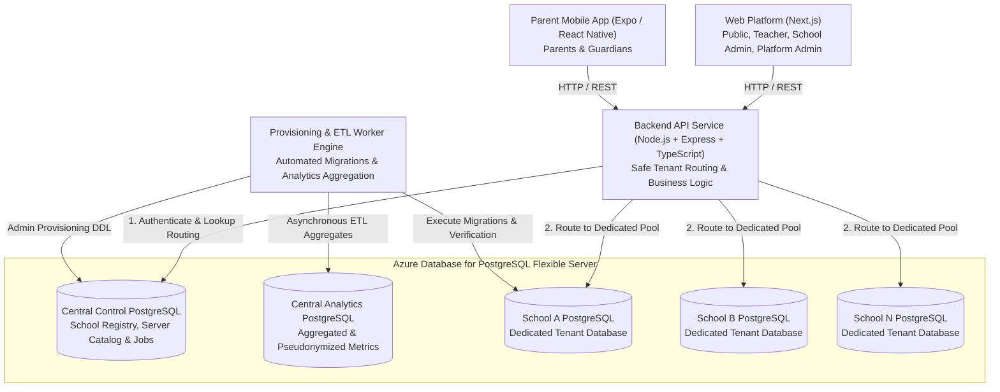

# Student Care — Architecture Overview

## 1. System Topology

## 2. Monorepo Organization

The project is structured as an npm workspaces monorepo:

- `apps/`
  - `web/`: Next.js 14+ application with App Router, Vanilla CSS, TypeScript.
  - `mobile/`: React Native application managed via Expo SDK, TypeScript.
- `services/`
  - `api/`: Express API with Zod validation, pg connection routing, structured logging, TypeScript.
- `packages/`
  - `shared-types/`: Central type definitions and API contracts imported across all workspaces.
- `docs/`
  - Architecture guides, requirements, and Architecture Decision Records (ADRs).

## 3. Dedicated Architecture Guides

Detailed architectural blueprints for specific subsystems:

- [Database Architecture & Schema Specification](file:///e:/Student%20Care/docs/architecture/database-architecture.md) — Central Control DB and School DB DDL, constraints, indexing, multi-school parent access, and attendance reconciliation rules.
- [Automated Provisioning Workflow](file:///e:/Student%20Care/docs/architecture/provisioning-workflow.md) — State machine, DDL execution boundaries, migration ordering, smoke tests, and rollback recovery.
- [Azure PostgreSQL Flexible Server Guide](file:///e:/Student%20Care/docs/architecture/azure-preparation-guide.md) — Compute/storage tiers, private networking, role privilege separation, and scaling strategies.

## 4. Safe Database Routing Pattern

### Central Control Database

Maintains:

- `schools`: Table recording `id`, `code`, `name`, `status`, `timezone`, `database_name`, and connection coordinates.
- `database_servers`: Multi-server catalog mapping tenant databases to specific Azure Flexible Server instances.
- `provisioning_jobs`: State machine tracking database creation, migrations, and verification.
- `tenant_migration_logs`: Cross-tenant migration history.

### Tenant Database Access Abstraction

1. Every incoming authenticated request contains a verified `schoolId` embedded in the cryptographically signed JWT session.
2. The `DatabaseRoutingManager` queries or utilizes cached routing coordinates for that `schoolId`.
3. An active `pg.Pool` connection pool is retrieved or established for that specific database name.
4. Client requests cannot specify arbitrary database names or connection strings. Any request with invalid format or unknown `schoolId` is rejected before any database operation.

## 5. Environment and Secrets Strategy

- Local development uses `.env` (derived from `.env.example`).
- Sensitive values (passwords, tokens, database URLs) are strictly excluded from git tracking via `.gitignore`.
- Production credentials should be injected via container environment variables or cloud secrets managers (Azure Key Vault with Managed Identities).
