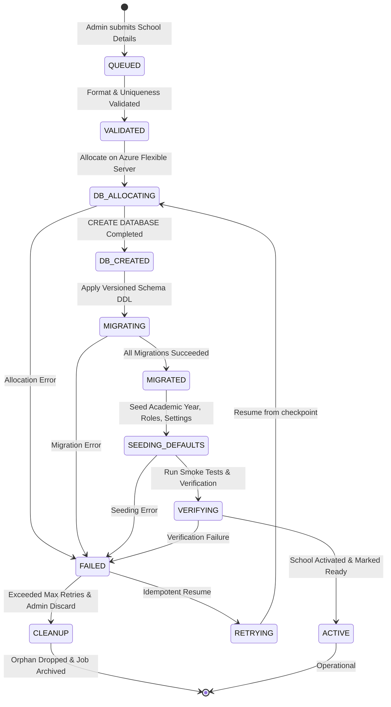

# Student Care — Automated School Provisioning & Recovery Workflow

**Status:** Approved Architectural Design  
**Author:** Platform Systems Architecture Team  
**Scope:** Multi-Tenant Database Allocation, Migration Execution, and Verification State Machine

---

## 1. Overview & Constraints

School creation in Student Care is exclusively initiated by authorized **Platform Administrators** via the Platform Admin Portal. Public self-service school registration is strictly disallowed.

### Key Technical Constraints

1. **PostgreSQL Transaction Limitation:** The command `CREATE DATABASE <name>` **cannot** run inside a multi-command transaction block (`BEGIN ... COMMIT`).
2. **Idempotency & Re-entrancy:** Provisioning operations may be interrupted (e.g., worker restart, network timeout). The engine must safely resume or retry without duplicating schema objects or creating orphaned databases.
3. **Privilege Separation:** Database creation requires an administrative role (`az_provisioner`), whereas normal operational API connections run under an unprivileged role (`az_school_app`).

---

## 2. Provisioning State Machine



---

## 3. Step-by-Step Provisioning Sequence

### Step 1: Input Validation & Unique ID Reservation

- **Admin Action:** Platform Admin submits school registration form:
  - Official School Name (e.g., `Royal College`)
  - Preferred Short Code (e.g., `RC-COL`)
  - Official Contact Email and Phone Number
  - Administrative Timezone (defaults to `Asia/Colombo`)
  - Target Server Selection (defaults to active primary Flexible Server)
- **Validation Engine:**
  - Verifies school code is globally unique (`REGEXP ^[A-Z0-9-]{3,12}$`).
  - Generates deterministic `school_id`: `sch_<sanitized_city>_<sanitized_name>_<counter>` (e.g., `sch_colombo_royal_001`).
  - Deterministically derives tenant database name: `sc_school_sch_colombo_royal_001`.
- **Database Action (Atomic in Control DB):**
  - Inserts row into `schools` with `status = 'PENDING_PROVISION'`.
  - Inserts row into `provisioning_jobs` with `status = 'QUEUED'`.

### Step 2: Database Allocation (`CREATE DATABASE`)

- **Worker Execution:**
  - Dedicated background provisioning worker picks up the `QUEUED` job.
  - Updates job status: `current_step = 'DATABASE_CREATION'`, `status = 'IN_PROGRESS'`.
  - Connects to target database server using the privileged provisioning pool (maintenance database `postgres`).
  - **Idempotency Check:** Checks if database already exists:
    ```sql
    SELECT 1 FROM pg_database WHERE datname = 'sc_school_sch_colombo_royal_001';
    ```
  - If not present, executes isolated DDL command (outside transaction):
    ```sql
    CREATE DATABASE sc_school_sch_colombo_royal_001
        WITH OWNER = az_school_app
        ENCODING = 'UTF8'
        LC_COLLATE = 'en_US.UTF-8'
        LC_CTYPE = 'en_US.UTF-8'
        CONNECTION LIMIT = 100;
    ```

### Step 3: Schema Migration Execution

- **Worker Execution:**
  - Opens direct connection to newly allocated database `sc_school_sch_colombo_royal_001`.
  - Updates job status: `current_step = 'SCHEMA_MIGRATION'`.
  - Reads migration files in sequence from repository migration catalog:
    1. `0001_core_schema.sql` (Users, roles, academic calendar, grades)
    2. `0002_students_guardians.sql` (Student records, parent links)
    3. `0003_attendance_biometrics.sql` (Devices, daily attendance, raw scans)
    4. `0004_grading_assessments.sql` (Subjects, exams, report cards)
    5. `0005_notices_notifications.sql` (Circulars, push logs)
  - For each migration:
    - Wraps in a distinct transaction:
      ```sql
      BEGIN;
      -- Execute migration SQL ...
      INSERT INTO tenant_migration_history (version, name, executed_at) VALUES ('0001', 'core_schema', NOW());
      COMMIT;
      ```
    - Records successful execution in Central Control DB `tenant_migration_logs`.

### Step 4: Seed Institutional Defaults

- **Worker Execution:**
  - Updates job status: `current_step = 'DEFAULT_DATA_SEEDING'`.
  - Inserts foundational system objects:
    - Default School Settings (`arrival_window_start = '04:00:00'`, `arrival_window_end = '14:00:00'`, `school_timezone = 'Asia/Colombo'`).
    - Default Academic Year (e.g. Current Year starting Jan 1 - Dec 31).
    - Standard Sri Lankan Grade structures (Grades 1 through 13).
    - Standard Grading Scale (`A: 75-100`, `B: 65-74`, `C: 55-64`, `S: 35-54`, `F: 0-34`).
    - Initial School Administrator credentials (temporary password with forced change on first login).

### Step 5: Verification & Smoke Testing

- **Worker Execution:**
  - Updates job status: `current_step = 'INTEGRITY_VERIFICATION'`.
  - Runs automated health validation queries against the tenant database:
    1. Verifies that all 16 required tenant tables exist.
    2. Verifies that unique constraints and foreign keys are active.
    3. Verifies that the unprivileged role `az_school_app` can perform DML operations (`SELECT`, `INSERT`, `UPDATE`).
    4. Validates write-read cycle against `academic_years`.

### Step 6: Activation

- **Control DB Update (Atomic Transaction):**
  ```sql
  BEGIN;
  UPDATE schools
  SET status = 'ACTIVE',
      provisioned_at = CURRENT_TIMESTAMP,
      updated_at = CURRENT_TIMESTAMP
  WHERE school_id = 'sch_colombo_royal_001';

  UPDATE provisioning_jobs
  SET status = 'COMPLETED',
      current_step = 'TENANT_ACTIVATION',
      completed_at = CURRENT_TIMESTAMP,
      updated_at = CURRENT_TIMESTAMP
  WHERE id = '<job_id>';
  COMMIT;
  ```
- **Notification:** Platform Administrator UI receives job completion webhook; onboarding welcome pack with initial School Admin credentials is dispatched.

---

## 4. Failure Recovery & Rollback Design

A reliable provisioning system must gracefully handle network disconnections, server timeouts, and syntax errors during DDL execution.

### Failure Classification

| Failure Scenario                                  | Recovery Strategy                                                                                                                          |
| :------------------------------------------------ | :----------------------------------------------------------------------------------------------------------------------------------------- |
| **Network interruption during `CREATE DATABASE`** | Worker retries; verifies `pg_database` existence before issuing `CREATE DATABASE`. If exists, proceeds to migration.                       |
| **Syntax or DDL failure in Migration step**       | Migration transaction rolls back automatically. Job marked `FAILED` with specific migration name and error log.                            |
| **Seeding or Verification failure**               | Database is retained in quarantine. Admin can trigger "Retry Provisioning" which resumes from the failed migration/seed step.              |
| **Terminal Failure / Abandoned Request**          | Admin selects "Rollback / Purge Orphan". Purge routine drops the unactivated database only after verifying `status = 'PENDING_PROVISION'`. |

### Idempotency Matrix

```
Check status:
IF step = 'DATABASE_CREATION' AND DB exists:
   SKIP CREATE DATABASE, ADVANCE TO 'SCHEMA_MIGRATION'
IF step = 'SCHEMA_MIGRATION':
   QUERY tenant_migration_history
   APPLY ONLY unapplied migrations
IF step = 'DEFAULT_DATA_SEEDING':
   USE INSERT ... ON CONFLICT DO NOTHING
IF step = 'INTEGRITY_VERIFICATION':
   RERUN smoke checks
```

### Safety Guardrails for Deletion / Cleanup

Under no circumstances may the automated system drop an `ACTIVE` school database:

```sql
-- Safe Cleanup Function
CREATE OR REPLACE FUNCTION purge_failed_provisioning(p_school_id VARCHAR) RETURNS VOID AS $$
DECLARE
    v_status school_status_enum;
    v_db_name VARCHAR;
BEGIN
    SELECT status, database_name INTO v_status, v_db_name
    FROM schools WHERE school_id = p_school_id;

    IF v_status <> 'PENDING_PROVISION' THEN
        RAISE EXCEPTION 'Cannot purge school %: status is % (only PENDING_PROVISION permitted)', p_school_id, v_status;
    END IF;

    -- Drop database logic executed via provisioning worker outside transaction
END;
$$ LANGUAGE plpgsql;
```
